<div align="center">

# 🌀 Portal

**Interactive session picker for zmx**

Fast, fuzzy session management from a bare shell, with project memory,
<br>path aliases, reboot-safe restoration, and a keyboard-driven TUI.

[](LICENSE)
[](https://go.dev)
[](#install)

[Install](#install) · [Quick start](#quick-start) · [Screenshots](#screenshots) · [How it works](#how-it-works) · [Commands](#commands) · [Documentation](#documentation) · [Coming from tmux](#coming-from-the-tmux-version)

<br>

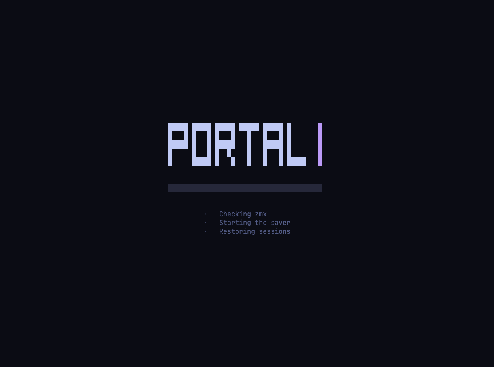

</div>

---

Portal runs at a bare shell and gives you an interactive TUI for picking, creating, and managing [zmx](https://github.com/neurosnap/zmx) sessions. It remembers your projects, resolves paths via aliases and zoxide, auto-detects git roots, and restores your saved sessions after a reboot.

After [shell setup](#shell-integration) you drive it through two functions: **`x`** (the picker and opener) and **`xctl`** (subcommands like `list`, `kill`, `alias`). Both names are configurable with `--cmd`.

## Why Portal?

zmx keeps sessions alive; getting back into the right one is the chore. Finding it means `zmx list` and a name you half remember. Starting one in the right place means a `cd`, a `zmx attach` and a name to invent. A reboot takes the lot, and bringing sessions back by hand brings every command back with them, all at once, whether you still need it or not.

Portal folds that into two shell functions and a picker:

- **One verb to get anywhere.** Open a project by path, alias or zoxide (`x work`), attach a session by name or glob (`x api`, `x 'api-*'`), or search your live sessions by name or directory (`x /api`). New sessions start at the git root, and Portal remembers your projects.
- **Reboot-safe sessions.** After a reboot Portal brings your sessions back, each in its last working directory with its ANSI scrollback.
- **Commands come back when you ask.** A session with a resume hook comes back holding a panel showing its command, which runs when you answer it, so a reboot doesn't start every dev server you ever left open.
- **A keyboard-driven picker.** It paints its own canvas, with a `?` keymap on every page. Six themes ship, matched to your terminal's background unless you pin one; drop-in `.theme` files restyle every screen, and `NO_COLOR` is honoured.
- **Grouping and tags.** One key flips the list between flat, by project and by tag. Tags live on directories, so every session opened there inherits them.
- **Scrollback preview.** `Space` peeks at any session's screen and scrollback, kept live while it's open, without attaching.
- **Multi-window open.** `x work api db`, or sessions marked with `m` in the picker, open each in its own terminal window, so a post-reboot window layout is back in one command. Ghostty works out of the box; other terminals through a `terminals.json` recipe.
- **One terminal at a time.** Opening a session takes it from any other terminal showing it, so it is drawn for yours from the first frame.

## Screenshots

<div align="center">
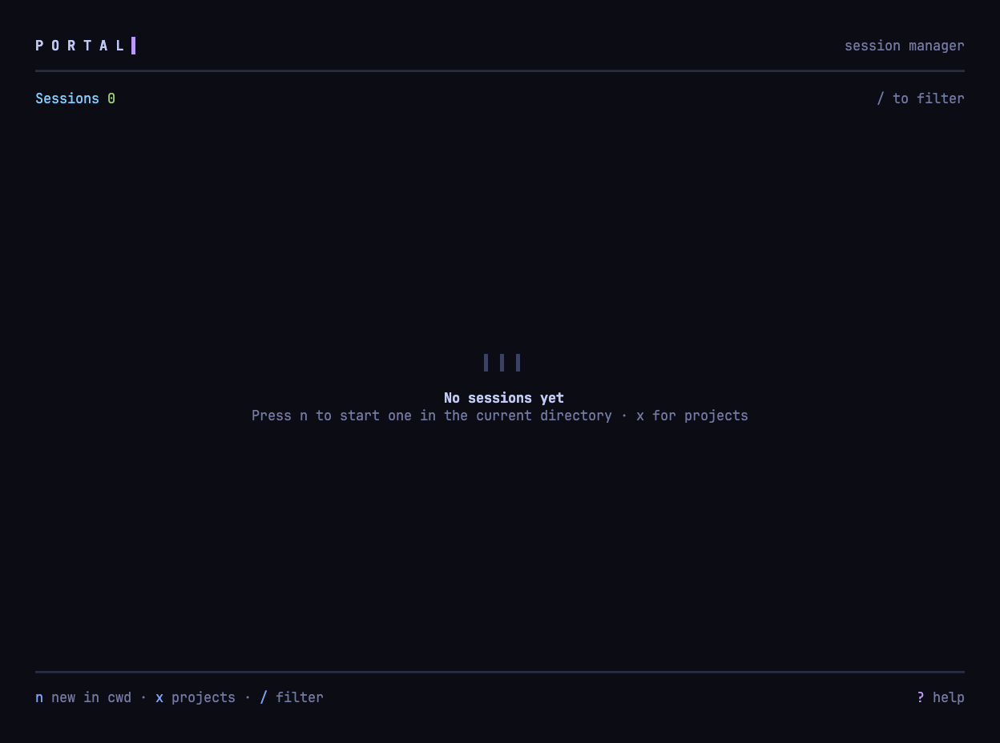
</div>

The full tour: grouping, fuzzy filter, scrollback preview, projects. Stills below; each opens the page that covers it.

|  |  |
|:---:|:---:|
| <a href="docs/picker.md#grouping-and-tags">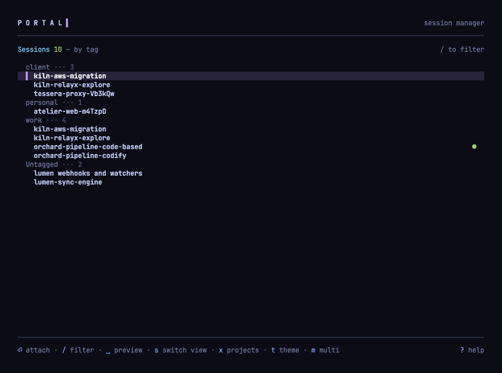</a><br>**Grouped by tag** | <a href="docs/picker.md#scrollback-preview">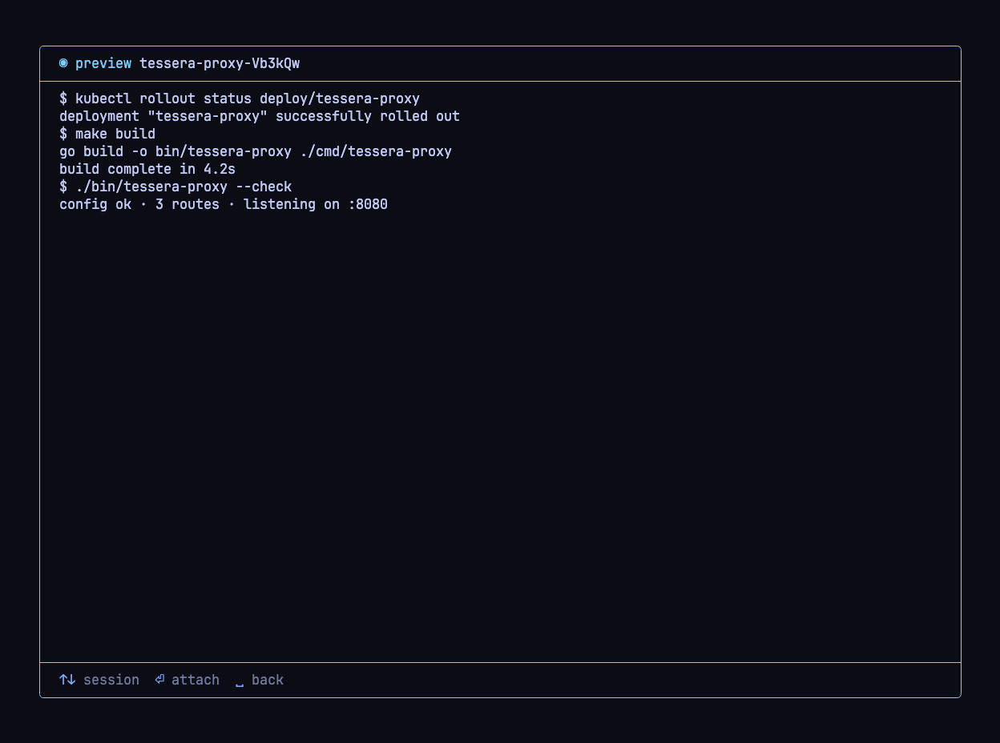</a><br>**Peek-mode scrollback preview** |
| <a href="docs/how-it-works.md#bootstrap-and-restoration">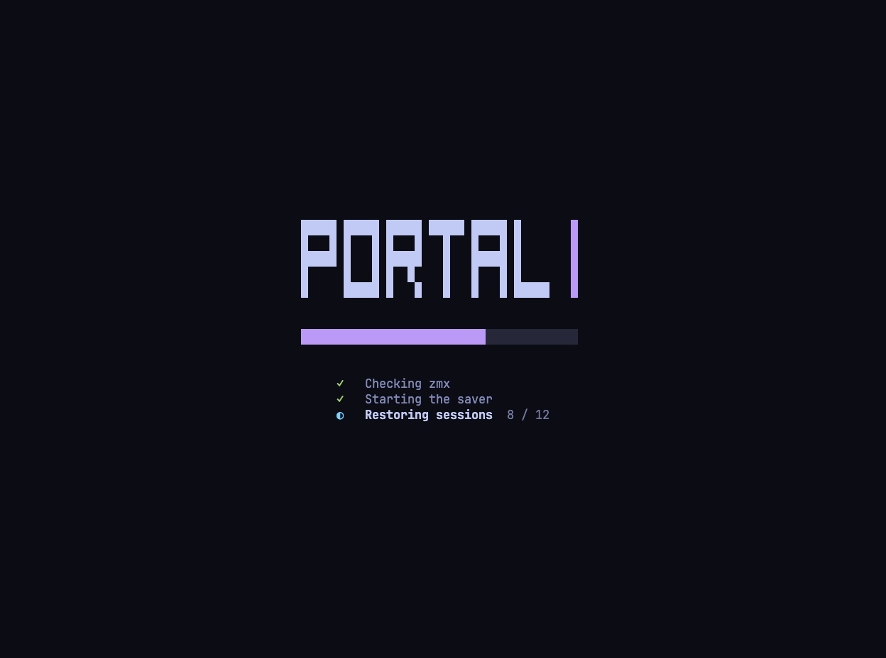</a><br>**Concurrent cold-boot loading** | <a href="docs/picker.md#keys">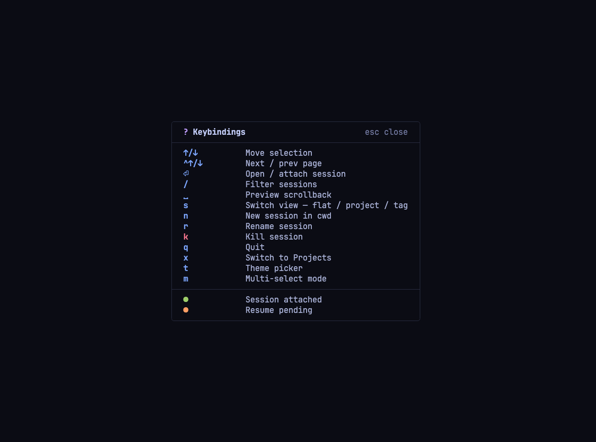</a><br>**Per-page `?` keymap** |
| <a href="docs/picker.md#projects">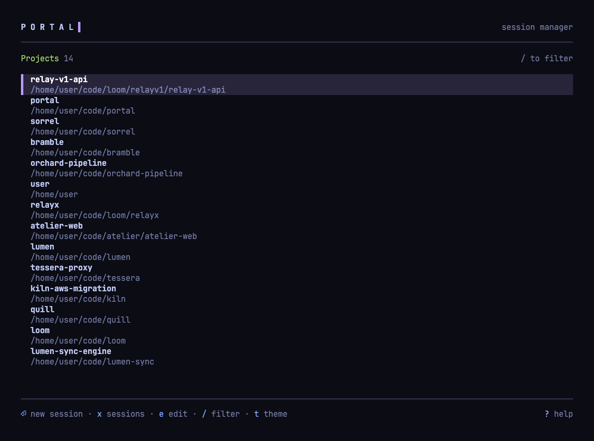</a><br>**Projects** | <a href="docs/picker.md#projects">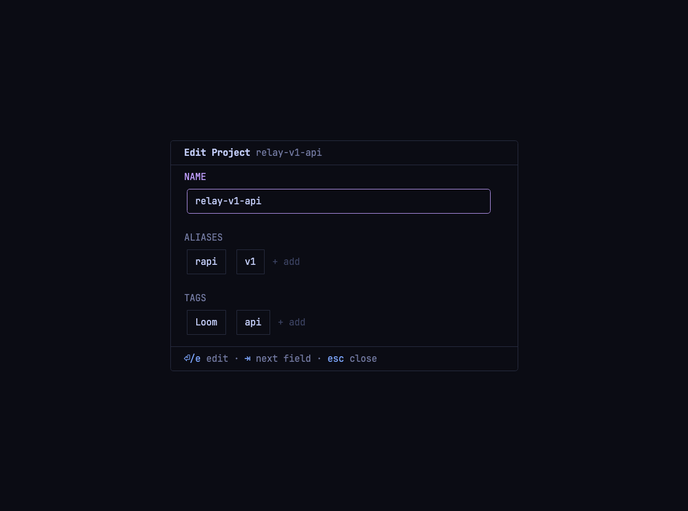</a><br>**Edit project: name, aliases, tags** |
| <a href="docs/picker.md#filtering">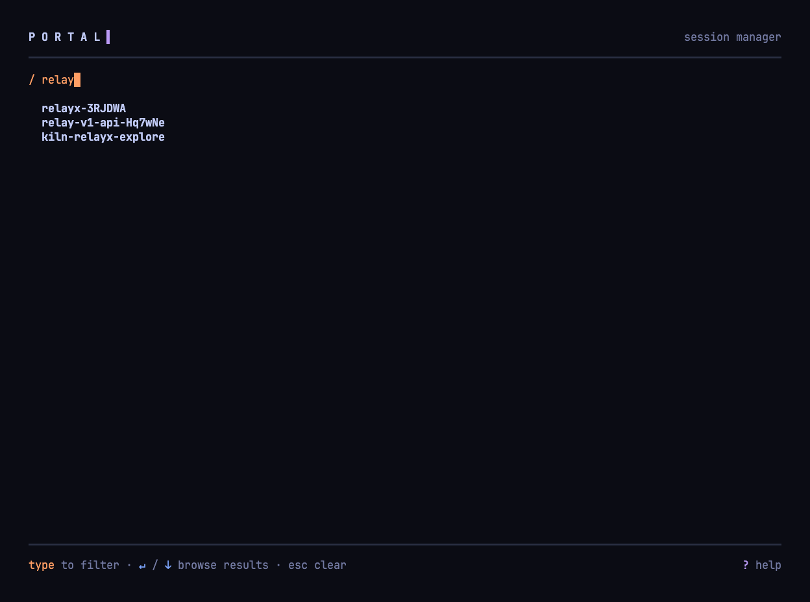</a><br>**Live fuzzy filter** | <a href="docs/picker.md#killing-a-session">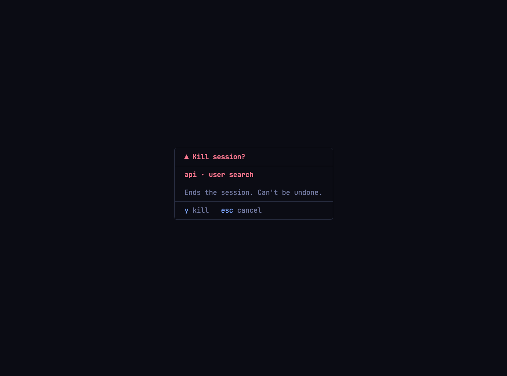</a><br>**Destructive confirm** |
| <a href="docs/resume.md#the-resume-panel">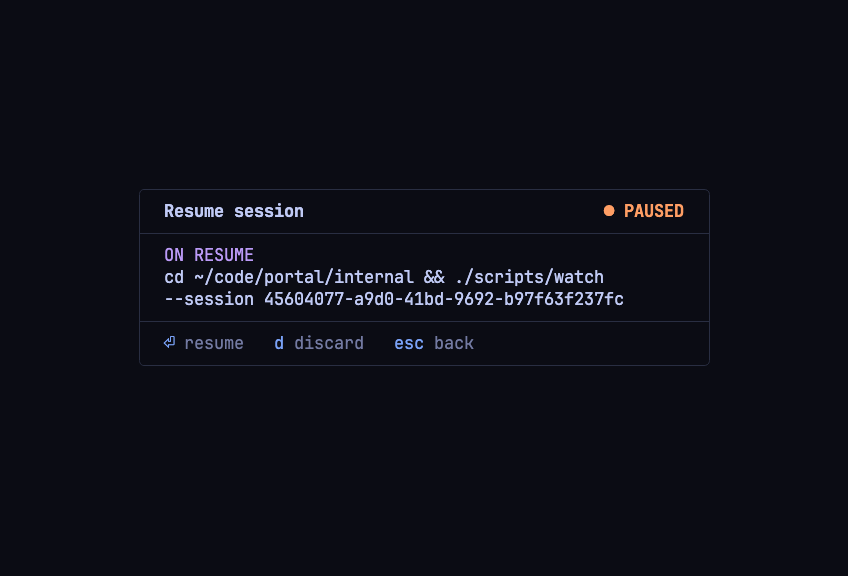</a><br>**Resume panel after a reboot** | <a href="docs/theming.md">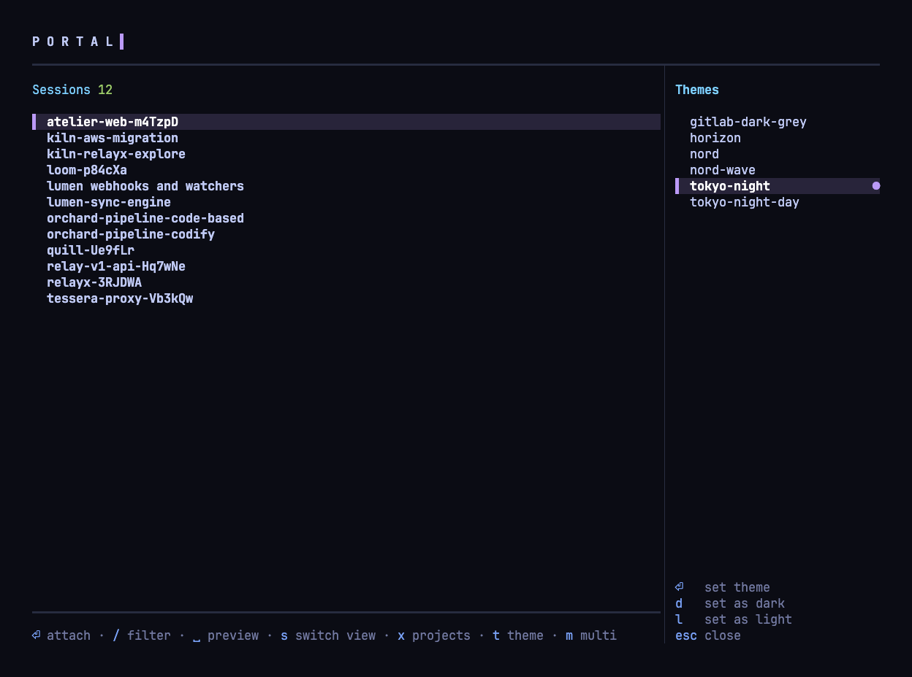</a><br>**Theme picker** |

<div align="center">

</div>

The six built-in themes: Tokyo Night, Tokyo Night Day, Nord, Nord Wave, GitLab Dark Grey and Horizon. The same screens render in light mode and under `NO_COLOR` (see [Themes](docs/theming.md)).

## Install

You need macOS and **[zmx](https://github.com/neurosnap/zmx)** 1.0.1 or later. Portal talks to zmx through its socket protocol 1; 1.0.0 was the first release to speak it, but its macOS downloads don't resize a session. What Portal refuses is in [zmx](docs/how-it-works.md#zmx). Building from source needs **Go** 1.26+.

```bash
brew install neurosnap/tap/zmx leeovery/tools/portal
```

zmx lives in its own tap, which Homebrew won't add or trust for a dependency, so the command names it beside Portal. Or, with Go:

```bash
go install github.com/leeovery/portal@latest
```

`go install` builds Portal alone: install zmx separately, with `brew install neurosnap/tap/zmx` or from [zmx's getting started guide](https://zmx.sh/getting-started).

To take Portal off again, see [Removing Portal](docs/commands.md#removing-portal).

## Quick start

```bash
eval "$(portal init zsh)"              # in ~/.zshrc — defines x and xctl (bash and fish below)

x                                      # the picker: ↑/↓ move, / filter, Space preview, Enter attach
x ~/Code/api                           # new session at the repo's git root
x ~/Code/api -e "make dev"             # ...with a command running in it
x /api                                 # later: search live sessions by name or directory
xctl alias set work ~/Code/work        # alias a path...
x work                                 # ...then open it by name
xctl hook set --on-resume "make dev"   # in a session: bring its command back after a reboot
xctl doctor                            # save daemon running? state sane? anything stale?
```

Your sessions are saved as you work. After a reboot the first `x` rebuilds them; see [How it works](#how-it-works).

While attached, `Alt+D` detaches back to the picker. On macOS the terminal must send Option as Alt for Portal's keys; see [Keys in a session](docs/sessions.md#keys-in-a-session).

## Shell integration

`portal init` prints the shell functions. Add one line to your shell profile:

```bash
# zsh
eval "$(portal init zsh)"

# bash
eval "$(portal init bash)"

# fish
portal init fish | source
```

This defines **`x`**, which launches Portal (the picker, or opening a target), and **`xctl`**, which runs Portal's subcommands (`list`, `kill`, `alias` and the rest). Name them something else with `--cmd`:

```bash
eval "$(portal init zsh --cmd p)"   # creates p() and pctl()
```

## How it works

Portal runs `zmx attach` itself and stays running while you're attached, watching for its own keys. A daemon in a hidden `_portal-saver` session saves what changed in your sessions, and after a reboot the first command that needs them brings the saver back and rebuilds every saved session that isn't already live. See [How it works](docs/how-it-works.md) for the whole of it.

## Commands

The examples use the default `x` / `xctl` names; with `--cmd p`, use `p` and `pctl`. You can also call the `portal` binary directly.

| Command | What it does |
|---|---|
| [`x`](docs/commands.md#x-open) | Opens the picker, or opens a session, a path, an alias or a zoxide match; several at once open several windows |
| [`xctl list`](docs/commands.md#xctl-list) | Lists running sessions |
| [`xctl kill`](docs/commands.md#xctl-kill) | Kills a session for good |
| [`xctl rename`](docs/commands.md#xctl-rename) | Sets the current session's label |
| [`xctl current`](docs/commands.md#xctl-current) | Prints the current session's label |
| [`xctl alias`](docs/commands.md#xctl-alias) | Sets, removes and lists path aliases |
| [`xctl hook`](docs/commands.md#xctl-hook) | Registers, removes and lists resume hooks |
| [`xctl doctor`](docs/commands.md#xctl-doctor) | Reports Portal's health; `--fix` makes the low-stakes repairs |
| [`xctl version`](docs/commands.md#xctl-version) | Prints Portal's version |
| [`xctl theme export`](docs/commands.md#xctl-theme-export) | Prints a theme's file, to start your own from |
| [`portal init`](docs/commands.md#portal-init) | Prints the shell integration |
| [`portal uninstall`](docs/commands.md#portal-uninstall) | Stops Portal's save daemon, leaving your sessions and config |

Every command and flag is in [Commands](docs/commands.md).

## Documentation

- [The picker](docs/picker.md): its keys, filtering, the Projects page, grouping and tags, the scrollback preview, and multi-select
- [Sessions](docs/sessions.md): opening a session, the search form, aliases and zoxide, keys in a session, and one terminal at a time
- [Resume hooks](docs/resume.md): bringing commands back after a reboot, and the resume panel
- [How it works](docs/how-it-works.md): zmx and its directory, the saver, and restoration after a reboot
- [Commands](docs/commands.md): every command and flag
- [Configuration](docs/configuration.md): the config files and their paths, `prefs.json`, the attach keys, logging and privacy
- [Themes](docs/theming.md): the colour roles, the `.theme` format, and the light/dark pair
- [Custom terminals](docs/custom-terminals.md): `terminals.json` recipes for opening windows on terminals other than Ghostty
- [Troubleshooting](docs/troubleshooting.md): `doctor`, `doctor --fix`, and the logs

[The design](docs/design/zmx-backend.md) is how Portal is built on zmx and why.

## Coming from the tmux version

Coming from the tmux version? This version is incompatible with its saved state: ask your agent to migrate it.

## Contributing

[`CLAUDE.md`](CLAUDE.md) has the house rules: how to build and test, and the invariants the code keeps.

```bash
go build -o portal .                                 # build
go test ./...                                        # unit lane
go test -tags integration -p 1 -timeout 30m ./...    # integration lane: real zmx and built binaries
golangci-lint run                                    # lint
```

- **Tests never touch the real system:** not your files outside their temp directories, your zmx sessions, or any process they didn't start. `CLAUDE.md` says how each boundary is held.
- **The pictures here are recorded** from the picker with every seam faked, never the real binary. [demo/README.md](demo/README.md) says how to record them again.

## License

MIT
