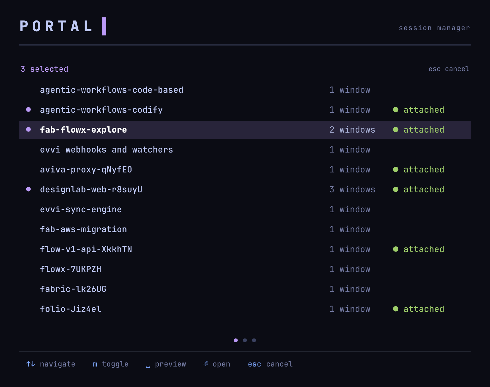
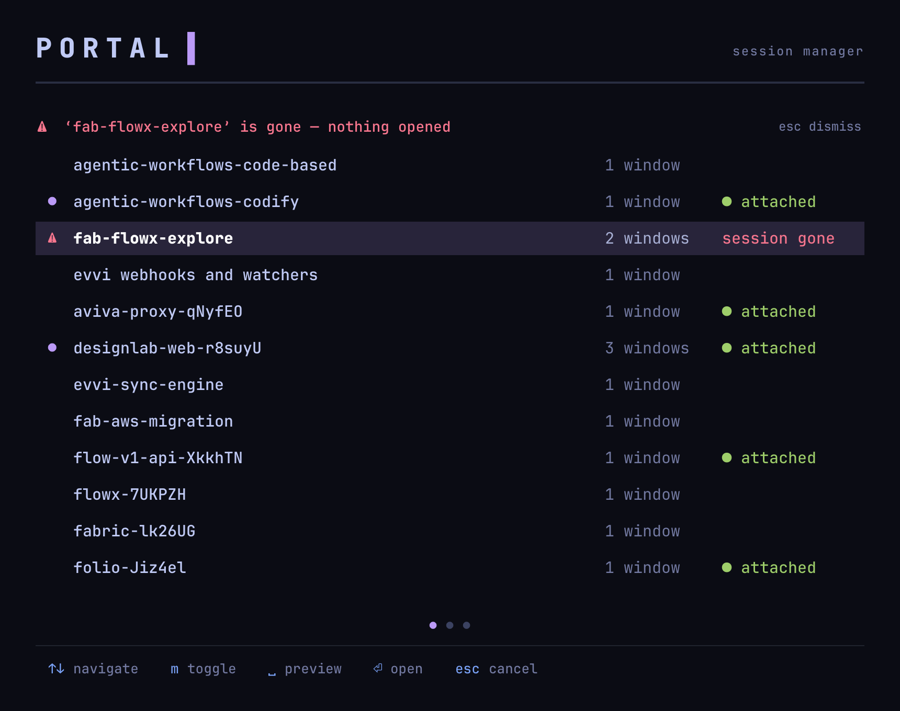
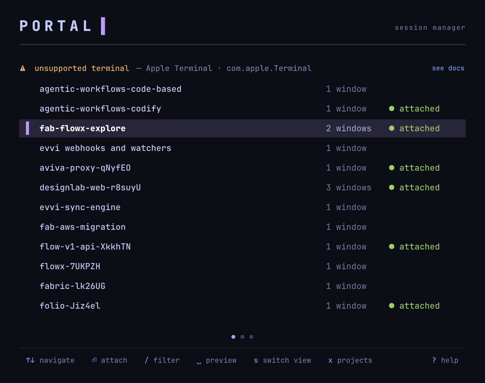

## Research

## Research: Restore Host Terminal Windows

Portal's resurrection layer restores the tmux/server layer after reboot, but not the **host-local terminal layer** — the actual terminal-emulator windows that were attached to sessions on this machine. This research explores whether Portal can track which terminal windows on *this host* were attached to which sessions, and then re-spawn and re-attach them on demand after a reboot, sparing the user from manually rebuilding their working state by hand.

### Starting Point

What we know so far:

- **Prompted by:** Portal's resurrection layer restores the tmux/server layer after reboot but NOT the host-local terminal layer. After a crash with ~32 Claude sessions, ~28 reattached correctly at the server level, but the user still had to manually rebuild every macOS terminal window by hand (~14 Spaces, one project zone per Space, each window holding a few sessions) — roughly an hour of work: open Ghostty, Cmd+N, drag to the right Space, attach, navigate, preview, confirm.
- **Already knows:** Feasibility is genuinely uncertain on two fronts — (1) distinguishing host-local attachment from tmux-level attachment that a mobile or other client could also hold, and (2) programmatically spawning terminal windows and re-attaching them to their sessions.
- **Starting point:** Technical feasibility — can Portal track which terminal windows on THIS host were attached to which sessions, and can it re-spawn + re-attach them on demand?
- **Constraints:** macOS Spaces placement (dropping each reopened window back onto its original Space) is explicitly out of scope — deferred as a separate Mac-specific follow-up. The user is biting this off in chunks; "reopen the windows" is its own job.

---

### Workflow & Topology (confirmed)

- **One Claude session ≈ one Ghostty window** is the norm. tmux *windows* used occasionally, panes rarely. So the unit of restore is: one host terminal surface per session.
- The tmux/server layer is **not in scope** — the existing resurrection layer already rebuilds tmux sessions/windows/panes on attach. This feature only restores the **host terminal surface** (the Ghostty window/tab) that fronts a session.
- macOS Spaces placement is **out of scope** (parked in inbox as a follow-up to build on top of this).

### The Refined Ask

Portal offers (never forces) a way to reopen N sessions, each springing into its own host terminal surface — **a Ghostty window or tab depending on how it was consumed before the reboot**.

Shape the user proposed: inside the Portal picker, a **multi-select keybinding** (e.g. `M`), select several sessions, `Enter`, and each attaches into its own new window/tab. Concrete scenario: go to Space 3, open Ghostty, `x`, `M`, select the project's 3 sessions, `Enter` → 3 surfaces spring open, each attached. *"Even if we stop there, that would be an amazing feature."*

### Key Reframe — multi-select dissolves most of the tracking problem

The manual multi-select trigger means we **do not** need to track the live window inventory ("what's open right now") or persist a window→session map for replay. The user drives the reopen by hand from a live Ghostty window. So:

- **Sessions already exist** post-reboot (resurrection layer restored them). Portal already knows them.
- The **only** new thing tracking buys is the **window-vs-tab consumption mode** per session — so a session that was a tab reopens as a tab, a window as a window.
- **Implication:** the MVP (multi-select + spring-open) needs *near-zero new tracking*. Window-vs-tab fidelity is a **separable refinement** — v1 could default to "always window" and add mode-tracking later. This is a natural scope seam, not a decision to make here.

**User preference (captured):** windows-only is acceptable for the MVP — the user rarely uses Ghostty tabs and is happy for a session that was a tab to reopen as a window. This **drops the window-vs-tab refinement from v1 scope** and, with it, the entire introspection requirement (see F2 below — Ghostty can't introspect tty/pid today anyway, so windows-only sidesteps the one hard blocker).

### Deep-Dive Findings (terminal automation surface — folded in as surfaced)

*Full report: `.workflows/.cache/restore-host-terminal-windows/research/restore-host-terminal-windows/deep-dive-001-terminal-automation-surface.md`. Verdict: **feature is feasible across all 5 target macOS terminals — spawn works everywhere.***

- **Spawn is solved on Ghostty today (F1).** Ghostty 1.3.x (user confirmed on 1.3.1) ships an AppleScript dictionary: `new window with configuration` where the config carries a `command` field — so Portal can open a new Ghostty window running `tmux attach -t <session>` directly. No keystroke hacks. The whole feature rests on spawn; spawn exists.
  - *Caveat (accepted):* each `new window` implicitly activates Ghostty / focuses the new window (issue #11457), so a burst multi-select flashes focus through the spawned windows. **User accepts this** — standard OS behaviour; only the end-state matters.
  - *Caveat:* Ghostty AppleScript is a "preview feature, breaking changes expected in 1.4" — the dictionary shape may churn.
- **Spawn command = `portal attach <session>` (code-validated, resolves review-002 F1).** Earlier note claimed the spawn runs bare `tmux attach` and "parity is free." Corrected against the code:
  - **`portal attach <name>` already exists** (`cmd/attach.go`): validates the session, then calls the **same connector the picker uses** — `SwitchConnector` (`tmux switch-client`) inside tmux, `AttachConnector` (`syscall.Exec` → `tmux attach-session -t =<name>`) outside. It's the existing Portal-mediated attach chokepoint.
  - **Resume/hydration is EAGER, at bootstrap** (step 6 Restore + step 7 `EagerSignalHydrate`) — *not* at attach. The connector is a pure tmux attach/switch with no resume logic. So a bare `tmux attach` would **not** skip resume-hooks (they already fired at bootstrap) — the earlier "parity" worry was misframed. The reason to use `portal attach` is **consistency/single-chokepoint**, not resume correctness.
  - **The behavioural model (user, confirmed against code):** *trigger window* attaches to one selected session via the existing in-picker connector (`switch-client` — picker process replaced, exactly as a single attach today); *the other N-1* are new host windows each running **`portal attach <session>`** from a fresh shell (outside tmux → `AttachConnector`). Not `portal open` (no re-running the picker — the selection's already made), not bare tmux. This also answers **review-002 F2** (picker-surface fate): the trigger window *becomes* one of the attached sessions.
  - **Net window count = N, not N+1 (user, emphatic anti-requirement).** Selecting 3 yields exactly **3** windows: the picker's host window is **reused** as one session (via `switch-client`, which replaces the picker process) + N-1 new windows. A **leftover empty picker window is explicitly forbidden** — the user must never have to close a stray empty window after a multi-attach. The reuse falls out of the existing `switch-client` behaviour for free.

### Cross-Terminal Strategy (emerging)

**Goal:** "just works" for current popular terminals — but **ship Ghostty only to begin with** (the user's Mac terminal). Others added over time.

**Platform stance (user):** macOS-first. AppleScript being Mac-only is fine. **No Windows.** Linux is "loosely supported, never tested" — explicitly *not* a goal; a Linux user who wants this can self-configure their terminal's command. So the design must degrade to "bring your own command" gracefully, but we don't write/test Linux adapters.

**Dual configurability (the core requirement):**
- **User-level config** — a user can add/override their terminal's spawn command without touching Portal's code (covers the long tail + Linux + customisation).
- **Binary-level (built-in) adapters** — known terminals work out of the box, zero config. New ones land via **open-source PR** (contribute the command/adapter so future users don't self-configure). This is an explicit contribution model.
- **Why configurable even for supported terminals:** users may want to *extend* the spawn (e.g. open + resize window + set title), which they'd do by editing the command.

**The contract (user's intuition — "that's almost a contract, isn't it?"):** every terminal, however implemented, answers one question: **given a session name, open a host window attached to it.** That single operation is the adapter contract. Built-in Go adapters and user-config entries are just two implementations of it.

**Representation of complex commands (open research question the user raised):** how does an AppleScript (multi-line, quote-heavy) live in config? Candidate shapes:
- **(a) Command/argv template** with a `{session}` placeholder — clean for CLI terminals (kitty `kitten @ launch`, wezterm `wezterm cli spawn`) and simple `osascript -e` one-liners. Avoids shell-quoting hell if expressed as an argv list, not a single string.
- **(b) External script file referenced by config** — for genuinely complex/multi-line logic (AppleScript + resize + title); config points to `~/.config/portal/terminals/<name>` and Portal runs it with the session passed as arg/env. Most flexible; keeps config clean; this is the "scriptable/pluggable" escape hatch.
- **(c) Built-in Go adapter** — for *known* terminals the AppleScript/CLI lives in compiled code (cleanly escaped, or written to a temp script), never in user config. User only touches config to override or add a terminal.
- *Leaning:* layered — (c) for known terminals (Ghostty), (a) for simple custom terminals, (b) as the power escape hatch. To be decided in discussion.
- *Script-vs-file disambiguation (user asked):* config value is either an inline command or a file path. Context-detection ("does it resolve to an existing file?") is viable and has precedent; safest is to treat an existing-path-on-disk as a script file, else as an inline command (or support an explicit form later). Low-risk either way. Decided in discussion.

**Decision — build the full user-config layer in v1** (user: "build all of it now"). Not just for other-terminal users — the user may want to override the native Ghostty command (e.g. add resize) and *will test the path*. So v1 ships: built-in Ghostty adapter **+** the user-config override/escape hatch.

**Precedence (user-proposed, sound + standard):** user **config override** (highest) → **baked-in native adapter** → **unsupported** (lowest). Config wins so an override is always possible; absence falls back to native; absence of both = feature unavailable in that terminal. This is the conventional config-over-default layering.

#### The keying spanner → resolved by detect-self (deep-dive F6)

The user hit a real snag: if Portal natively supports only Ghostty, how does a Warp user's config get *found*? Is config keyed by terminal name, or is it just "a spawn command" Portal runs blindly (in which case Portal doesn't know which terminal you're in — and **users use multiple terminals**, breaking a single blind command)?

**Resolution (F6):** Portal **detects the host terminal it is running in** from environment variables, and *that* is the lookup key. The flow when you hit `M`: detect current terminal → look up (config override for that terminal? → native adapter for it? → unsupported). This resolves both halves of the spanner:
- **"How does Portal know which terminal?"** — env-var detection (`TERM_PROGRAM` + app-specific vars).
- **"Multiple terminals?"** — it keys off whichever terminal you're *currently working in* when you trigger the reopen, which is exactly the terminal the new windows should spawn into. The multi-terminal case is a feature, not a bug.

**Gotcha (F6, Portal-specific, confirmed live):** **tmux clobbers `TERM_PROGRAM`** — inside tmux it reads `tmux`, not `ghostty`. So detection must lean on **app-specific env vars that survive the tmux rewrite** (`GHOSTTY_*`, `KITTY_*`, `WEZTERM_*`, `ALACRITTY_*`), falling back to `TERM_PROGRAM`/`TERM`. Edge: tmux only preserves vars present when the *server* started; `update-environment`/`show-environment` could recover the originating client's env if needed. This is the one non-trivial wrinkle in the otherwise-clean detect-self story.

#### Multi-select as a general mechanism (architectural note)

The user asked whether multi-select could later serve other actions (e.g. **bulk tag-adding**). Takeaway for v1: implement multi-select as a **general selection mode with spawn as its first action**, not a spawn-only modal — so future bulk operations can hang off the same selection. *Bulk-tagging itself is out of scope* (and would live on the **Projects** page = a separate feature; this feature's multi-select is **Sessions**-only). Noted, not built.

#### Unsupported-terminal UX (decided — banner, not modal)

**Decision:** multi-select does **not** vanish in an unsupported/unconfigured terminal (it may serve future non-spawn actions, so hiding it wholesale is wrong). Instead, on trigger, show an **info banner** (Portal already has the component) — *"We don't support your terminal and you haven't configured one — check the docs."* No modal (a modal hides everything). The banner should name the **detected terminal identity** so the user knows exactly which config key to add (see identity resolution below). This resolves review-F8.

#### The terminal-identity problem (the real crux — user pushback, now reframed)

The user correctly broke the naive "detect via env vars" story (review-F13 independently flagged the same): env vars alone (a) don't generalise to *unknown* terminals, (b) shouldn't be user-set, and (c) — the killer — **don't tell the user what string to key their config against**. For config lookup to work, the user's key must match Portal's detected identity, but the user has no way to know that string a priori. Chicken-and-egg.

**Reframed resolution (to be verified by deep-dive 002):** identity comes from the **host terminal's actual process**, not env vars:
- `tmux list-clients` → the **client PID** (the host-side `tmux attach` process, living *outside* tmux's env-clobber).
- Walk that PID **up the process tree** → the terminal-emulator process (`ghostty`, `kitty`, `wezterm-gui`, `Warp`, `iTerm2`). Deterministic, works for **any** terminal (you always get a process name), works inside tmux.

**This breaks the chicken-and-egg:** Portal owns the canonical identity and **surfaces it to the user** (in the unsupported banner, or a detect command). The matching key flows *Portal → user*, never user-guesses. Native adapters match the detected process against a built-in list; config entries are keyed by the same detected string.

**Consequences:** multi-terminal Just Works (detect per-invocation what you're *currently* in → look up that). The "one terminal at a time" simplification the user floated is **not needed**.

**Open edges to verify (deep-dive 002):**
- **Multi-client ambiguity** — when several clients are attached to one session, which client is "the one viewing me"? Does tmux expose a deterministic signal, or does a plain `tmux` subprocess just get the most-recently-used client?
- **Detached-session / no-client** case (less relevant — the user is *in* a terminal when triggering).
- **Most stable identity key on macOS** — executable basename vs `.app` bundle id (e.g. `com.mitchellh.ghostty`).
- **Post-reboot scenario** — a fresh terminal window attaching to an already-running server: does the client-PID→process-tree walk still resolve correctly (this is where the env-var approach was fragile, F13)?
- Layering: process-tree as the reliable backbone, env vars as an optional fast-path/confirmation.

**VALIDATED LIVE (2026-06-30, read-only on the running server) — detection works, with one refinement:**

Deep-dive 002 verified the mechanism, then a live re-run nailed it during a real device-hop. This session was **born in Blink/mosh (iPhone)**; the user then moved to **Ghostty on the Mac**, same tmux session. Detection re-run:
- **Process-tree walk from the chosen client PID → `/Applications/Ghostty.app/Contents/MacOS/ghostty` → bundle id `com.mitchellh.ghostty`.** Correct. Confirms the key property: identity is **where the session is *currently* running, not where it was started** — exactly the device-hopping behaviour the user needs.
- **Recommended identity key = macOS bundle id** (`com.mitchellh.ghostty`), shown to the user as the config key. Executable basename is unsafe (Warp's is literally `stable`).
- **Remote clients = honest no-op:** the two lingering mosh clients walked to `mosh-server` at `ppid=1`, **NULL bundle id** → "no host-local terminal" → unsupported → banner/no-op. So **Blink is a no-op by design** (not configured out of the gate; could become config/core later) — aligns with user intent. This also answers the original host-local-vs-other-client feasibility worry: the NULL-bundle signal *is* the host-local discriminator.

**RESOLVED — bundle id is the right *internal* key, matched as a family, with a friendly alias on top (deep-dive 003):**

- **Not a code smell — it's the system-blessed identity.** `CFBundleIdentifier` is what Launch Services, `open -b`, the TCC permission DB, keychain, default-app associations, and `osascript -e 'id of app "X"'` all key off. Keying on basename/display-name *would* be the smell; bundle id is the cure.
- **"What if they change it?" — they effectively can't, per product line.** Changing a bundle id resets TCC permissions, breaks keychain access, destroys the App Store record, and breaks code-sign/Sparkle updates — so vendors treat it as immutable for a product's life. Empirically near-zero churn per channel. There is **no "app GUID"** on macOS; bundle id (± Team ID) *is* the persistent identity.
- **The real catch — match a *family/set*, not one string.** Channels/forks carry *different* ids: Warp `dev.warp.Warp-Stable` vs `-Preview`; VS Code `com.microsoft.VSCode` vs `…VSCodeInsiders`. (iTerm2 *shares* one id across stable+beta — vendor-dependent, no universal rule.) So each built-in adapter declares an **id family** — a known-id set and/or a prefix pattern (`dev.warp.Warp-*`). Pure single-string match is the one design to avoid.
- **Internal key ≠ user-facing key (resolves the "iffy" worry).** User-facing primary key = a **friendly alias** (`ghostty`, `warp`) backed by an alias table mapping to the id family; raw bundle id / `*`-glob is the escape hatch for custom/unknown terminals. Portal **always shows the detected bundle id** (so a custom-config user copy-pastes, never guesses). Proven pattern in the wild: Karabiner (bundle-id regex families), Raycast (name|id|path), VS Code (`.app`-name user-facing key).
- **Unknown-terminal keying — NOT a chicken-and-egg (user follow-up).** The Portal-managed friendly alias only covers *known* terminals; an unknown terminal has no pre-baked alias. But the user never *guesses* the identity — the walk recovers both the **bundle id** *and* the **`.app` name** (`Warp`), and Portal **displays** them (unsupported banner / detect command), so the config key is copy-paste. **The irreducible floor:** for an unknown terminal, the *only* genuinely user-authored input is the **spawn command** (how *that* terminal opens a window) — Portal can't know that for an app it's never seen. Identity is always detected-and-shown; only the spawn recipe is authored.
- **Two keys, two jobs (clarified — don't collapse them).**
  - **Internal matching key = bundle id (family).** Robust + channel-aware: `dev.warp.Warp-*` groups Stable/Preview cleanly. This is what Portal's *shipped adapters* match on; the user never types it.
  - **User-facing config key = `.app` name** (`Warp`) preferred — friendlier, VS Code precedent (`terminal.external.osxExec`). Safe because a user registering a *custom* terminal names their *one* terminal, not a channel family.
  - **Why not `.app` name internally too:** channel siblings *diverge* by `.app` name (`Warp.app` vs `Warp Preview.app`) — worse at grouping than the bundle-id prefix. So `.app` name is friendlier but weaker for family matching; use bundle id where precision matters, `.app` name where ergonomics matter. Both recovered by the same walk; both shown.
  - **DISCUSSION-PHASE UX call (not feasibility):** what Portal *defaults to displaying*, and whether custom config accepts `.app` name *and* bundle id (and `*`-glob). Options + tradeoffs surfaced; the pick is a discussion decision.
- **Optional hardening (deferred):** Team ID + bundle id (from code-signing) is the most tamper-resistant/anti-spoof key, but heavier to read and overkill for a local convenience feature — defer unless impersonation enters the threat model.
- **Degrade:** unknown local terminal → show detected id + offer "register a custom terminal"; NULL bundle id (remote/mosh) → no host-local terminal, skip. **Cross-platform:** the alias + canonical-key + adapter-family model transfers; only the leaf key is per-OS (Linux: `.desktop` id / `WM_CLASS` / `app_id`).

**Refinement (live finding — corrects deep-dive 002's F2/F7):** the session had **3 clients** attached (2 stale mosh + 1 live Ghostty). The disconnected mosh client **still carried the `focused` flag** (stale). Tie-breaking on `focused` picked the wrong (mosh) client; tie-breaking on **highest `client_activity`** (tmux's own `cmd_find_best_client` rule) correctly picked Ghostty. **Decision: resolve the client by highest `client_activity`, treat `focused` as an unreliable hint** — load-bearing precisely because the user hops devices and mosh clients linger after disconnect. Residual: multi-client is still best-effort (most-recently-active ≠ provably "the window in front of the human"), but for this feature, triggering the reopen bumps the active client's activity, so the current terminal wins.

### Forward-Looking (out of scope — "keep half an eye")

The user flagged a **future** feature (explicitly *not* this one): on reboot, **remember what was open** and offer *"restore your workspace?"* — re-opening windows **and placing them on their original macOS Spaces**. Different mechanism from this feature's manual multi-select (remember-and-restore vs select-and-open). Spaces placement is **already parked in the inbox**.

Architectural impact on *this* feature: "remember what was open" implies **introspection returns as a requirement later** (to record the workspace), and Spaces placement adds a **window-placement** capability. So the adapter contract should be **capability-based** (spawn is the v1 method; leave room for an optional `introspect` and `place-on-space` later) rather than a single rigid function — so v1 doesn't paint the architecture into a corner. Design v1 minimal (spawn only) but extensible. *Noted, not designed here.*

### Two Feasibility Risks (original framing — BOTH now resolved/dropped)

*These were the two "I have no idea if it's possible" risks that opened the research. Both are now closed — recorded here as the through-line from question to answer.*

1. **Spawn — RESOLVED.** Can Portal programmatically open a new window running a command? **Yes** (deep-dive 001): Ghostty 1.3 AppleScript `new window with configuration … command`, and spawn works across all 5 target terminals. The central risk the feature rested on is cleared.
2. **Detect mode — DROPPED (not resolved — removed from scope).** "Window vs tab" detection is no longer needed: the **windows-only MVP** dropped window-vs-tab fidelity, which removed the entire introspection requirement. (The *separate* "which terminal am I in" detection — not mode — was the real detection problem, and it's resolved via the process-tree walk in deep-dive 002.)

### Mechanism Notes (from KB + tmux knowledge)

- `tmux list-clients -F '#{client_tty} #{client_session} #{client_pid} ...'` exposes the live client→session map plus the client's tty and pid (verified tmux 3.6a in the zellij-to-tmux-migration discussion). `client_pid` → ppid chain is the likely path to "is this client a local Ghostty surface."
- Portal already runs a **1s tick daemon** (`portal state daemon` inside `_portal-saver`) that captures session structure to `sessions.json`. The user's "keep a tick / log of how it's consumed" maps directly onto this existing seam — consumption-mode could ride the same capture loop.
- The **"host-local vs other client" distinction** (original feasibility worry) softens under manual multi-select: the daemon runs on *this* host and the user reopens from *this* host, so a future mobile/relay client (per `agent-first-portal`) attaching to the same session wouldn't masquerade as a local window to reopen. The user has final say via the selection anyway.

### Operational & Edge Surfaces (from review-001)

The research is strong on terminal-automation feasibility but thin on operational/product surfaces. Captured here for discussion; some already resolved above.

- **Burst failure modes (review-F1)** — the motivating scenario is a *large* burst (rebuild ~14 windows post-crash), yet the research reasons about the clean 3-window path. Partial failure (spawn/attach of window K fails — session killed since picker load), AppleScript throughput/rate-limit under rapid-fire, and the mid-burst TCC prompt all unexplored. Need a partial-failure contract: all-or-nothing vs best-effort-with-report.
- **Trigger-context matrix (review-F2)** — behaviour when: user is *outside* tmux at trigger; a selected session is *already attached* elsewhere on this host; the picker is itself running in one of the windows being reopened. Map in/out-of-tmux × attached/detached × includes-self.
- **Duplicate-surface guard (review-F3)** — **DECIDED: no guard, allow it.** Opening a session that's already attached is a fine no-op — *"it's all through tmux, so both opens synchronise perfectly"* (user). No blocking, no skip, no warn; if the user multi-selects already-open sessions, Portal opens them. This also means windows-only v1 needs **zero** client-state read for dedup (it still reads `list-clients` for *detection*, but not to filter selections).
- **First-run TCC Automation permission (review-F4)** — first AppleScript call triggers the one-time macOS permission modal (the deep-dive author's own probe timed out on it, AppleEvent -1712). First-run blocker, not a caveat. Design the request→granted→spawn / denied→guidance flow; surface -1712/timeout rather than silently doing nothing.
- **Testing strategy (review-F5)** — feature drives a real GUI terminal (hard in CI); project has deep test discipline. Identify the DI seam (an `Adapter` interface with a fake spawn), what's unit-testable (command/argv construction, detect-self resolution, precedence) vs integration/manual-gated.
- **Where spawn executes architecturally (review-F6)** — picker action shelling out from the TUI process vs a new `portal` subcommand the picker invokes vs both. Determines which process's env feeds detect-self, how the `tmux attach` line is assembled, and whether a headless/scriptable reopen is possible. **Coupled to identity detection (deep-dive 002)** — resolve together.
- **Keymap coexistence (review-F7)** — `M` selection mode vs the tight §12.2 keymap: `Enter` (single attach) and `Space` (preview) collide with selection-mode semantics; interaction with non-selectable HeaderItem rows, the `/` filter (letters become literal), and pagination all unwalked.
- **Config schema (review-F9)** — v1 *ships* the user-config layer, so its concrete shape is more than a discussion detail: where it lives, format, how a terminal key maps to a command, `{session}` interpolation. Surface at least one worked example (a Warp user overriding spawn).
- **Daemon/state footprint (review-F10)** — "near-zero state change" asserted as a corollary, not traced. Confirm which packages (state, daemon, prefs, a new config package) are/aren't touched by windows-only v1.
- **Attach contention (review-F12)** — *open.* N near-simultaneous `tmux attach -t` against a server that may still be hydrating post-reboot (`@portal-restoring`, 1s capture tick, self-supervising daemon): genuinely independent of the bootstrap/restore/daemon machinery, or racing it?

#### From review-002 (final review)

- **Success framing — partial win accepted (review-002 F6, DECIDED).** The MVP is a *steady-state* multi-select that collapses the N attaches into one action per batch; it does **not** remember which sessions grouped together, nor place Spaces. Against the post-crash motivating story that's a **partial** win (still manual re-selection per zone, still manual Spaces). **User accepts this explicitly** — *"okay with a partial win; iteratively moving towards perfect."* Remember-the-grouping + Spaces are the deferred follow-ons. Stated here so discussion has the yardstick: MVP = "collapse the attaching," not "restore the workspace."
- **Spawned window cwd/env (review-002 F3) — mostly dissolves; one impl flag.** Because each new window runs `portal attach <session>` (attaches to an *existing*, already-restored session), the window's pre-attach **cwd is moot** — tmux pane cwds are session state and take over on attach. The only real concern is **env/PATH**: the spawn must run `portal attach` in a context where `portal`/`tmux` are on PATH (Ghostty's `surface configuration.command` may not be a login shell) — an implementation detail for spec, not a design decision.
- **Detection-primitive stability (review-002 F4) — validation-before-build flag.** The identity backbone (`ps -o comm=` full-path behaviour, `lsappinfo` bundle-id read, GUI app at `ppid==1` under launchd) is verified on *one* Mac at *one* moment. `lsappinfo` is undocumented. Before build: confirm the `ps`/`lsappinfo` behaviours on ≥1 other macOS version and decide a fallback when `lsappinfo` is absent/unexpected (it's the single point of failure for the canonical key). Not a feasibility blocker; a hardening item.
- **Activity-bump tie-break timing (review-002 F5) — validation-before-build flag, higher priority.** The load-bearing mitigation for multi-client detection is "pressing `M` bumps the triggering client's `client_activity` so the local client wins." Asserted, not verified — and the user's device-hopping with lingering mosh clients is exactly where it could break (a phone-touched-seconds-ago client could outrank the local one at read time). Before build: stage a two-client session (one stale-recent, one local), trigger from local, confirm `client_activity` ordering. If it doesn't hold, detection needs a stronger signal than activity.

### Open Questions

*The early feasibility open-questions are all now resolved or dropped (kept here as dispositions). The **live** open items that carry into discussion are the design/validation flags in "Operational & Edge Surfaces" above — not these.*

- **Ghostty spawn** — RESOLVED (deep-dive 001: AppleScript `new window … command`).
- **Mode detection (window-vs-tab)** — DROPPED (windows-only MVP).
- **Other terminals** — RESOLVED into the **Cross-Terminal Strategy** (built-in adapters keyed by bundle-id families + user-config escape hatch; Ghostty-first).
- **Trigger surface / `M` keymap coexistence** — still open → tracked as **review-F7** (a discussion-phase design item).
- **Where does spawn run from?** — partially answered (the N-1 new windows run `portal attach <session>`; the trigger window reuses the picker via `switch-client`) but the *architectural placement* (picker action vs subcommand) is still open → tracked as **review-F6**, to resolve with detection.

**Carried into discussion (live):** see "Operational & Edge Surfaces" — burst/partial-failure contract (F1), trigger-context matrix (F2), TCC first-run flow (F4), testing seam (F5), spawn-execution architecture (F6), `M` keymap coexistence (F7), config schema (F9), daemon/state footprint (F10), attach contention (F12); plus review-002's validation-before-build flags (lsappinfo/ps stability, activity-bump timing) and UX picks (default identity display, config key forms).

### Triage

(none)

## Discussion

## Discussion: Restore Host Terminal Windows

### Context

Portal's resurrection layer restores the **tmux/server layer** after reboot (sessions/windows/panes rebuild on attach), but not the **host-local terminal layer** — the actual terminal-emulator windows that fronted those sessions. After a crash with ~32 sessions, ~28 reattached at the server level, but the user still rebuilt every macOS terminal window by hand (~14 Spaces, one project zone per Space) — roughly an hour of manual work.

This feature lets the user spawn N sessions, each springing into its own host terminal surface, via a **multi-select** in the Portal picker. Research closed the feasibility questions and locked a set of foundational decisions; this discussion resolves the **live design and operational decisions** that remain.

#### Foundation already settled in research (not re-litigated here unless spawned)

- **Core shape:** a Sessions-page **multi-select mode** (proposed `M`) → select sessions → `Enter` → each springs open in its own host window, attached. Implemented as a *general selection mode* with spawn as its first action (future bulk ops can reuse it).
- **Windows-only:** window-vs-tab fidelity dropped → removes the entire introspection requirement.
- **Spawn command:** the N−1 new windows each run **`portal attach <session>`** (existing chokepoint connector); the **trigger window is reused** as one session via `switch-client`. Net window count = **N, not N+1** (no leftover empty picker window — a hard anti-requirement).
- **Cross-terminal:** Ghostty-first; **dual configurability** (built-in Go adapters + user-config override/escape hatch), both shipped in this feature. Precedence: **config override → native adapter → unsupported**.
- **Identity (feasibility-validated live):** detect the host terminal via **client-PID → process-tree walk → macOS bundle id**, matched as a **family** (e.g. `dev.warp.Warp-*`), with a **friendly alias** (`ghostty`) as the user-facing key. Remote/mosh clients → NULL bundle id → honest no-op. *(Which-client selection was **refined in #7** by live validation: NULL-filter to the local client(s) first, `client_activity` demoted to a local-only tiebreak — raw highest-activity and `focused` both proved unreliable across clients. Do not lift the activity-centric framing from research.)*
- **Unsupported-terminal UX:** info **banner** (not modal) naming the detected identity.
- **Duplicate-surface guard:** none — opening an already-attached session is a fine no-op (tmux synchronises both).
- **Scope yardstick:** this feature is "collapse the attaching into one action per batch" — a **partial win** the user explicitly accepts. Remember-the-grouping + macOS Spaces placement are deliberately separate future features (Spaces already parked in inbox).

#### References

- Research: [restore-host-terminal-windows.md](log.md#research)
- Deep-dives (cache): terminal-automation-surface (001), identity-detection (002/003)

### Discussion Map

A living index of subtopics tracked during the discussion. Grows as the conversation branches, converges as decisions land.

#### States

- **pending** (`○`) — identified but not yet explored
- **exploring** (`◐`) — actively being discussed
- **converging** (`→`) — narrowing toward a decision
- **decided** (`✓`) — decision reached with rationale documented

#### Map

  Discussion Map — Restore Host Terminal Windows (13 subtopics — 13 decided)

  ┌─ ✓ 1. Spawn-execution architecture — where the spawn runs from [F6] [decided]
  ├─ ✓ 2. Multi-select trigger & keymap coexistence [F7] [decided]
  ├─ ✓ 3. Burst & partial-failure contract [F1] [decided]
  ├─ ✓ 4. Trigger-context matrix (in/out tmux × attached × includes-self) [F2] [decided]
  ├─ ✓ 5. TCC first-run Automation-permission flow [F4] [decided]
  ├─ ✓ 6. Config schema & command representation [F9] [decided]
  ├─ ✓ 7. Terminal-identity UX — what we display & accept as config key [rv2-UX] [decided]
  ├─ ✓ 8. Adapter contract shape & extensibility (capability-based) [fwd-looking] [decided]
  ├─ ✓ 9. Testing strategy & DI seam [F5] [decided]
  ├─ ✓ 10. Daemon / state footprint (windows-only) [F10] [decided]
  ├─ ✓ 11. Attach contention vs post-reboot hydration [F12] [decided]
  ├─ ✓ 12. Pre-build validation flags (validated live) [rv2-F4/F5] [decided]
  └─ ✓ 13. Design in Paper — page + interactions (3 frames delivered + approved) [decided]

---

*Subtopics are documented below as they reach `decided` or accumulate enough exploration to capture.*

---

### 1. Spawn-Execution Architecture

#### Context

Research (review-F6) framed this as "where spawn executes architecturally": picker action shelling out from the TUI process vs a new `portal` subcommand vs both — flagged as coupled to identity detection because it determines which process's env feeds detect-self, how the attach line is assembled, and whether a headless/scriptable spawn is possible. It's the keystone: settling it shapes the config schema, test seam, and daemon footprint.

#### The constraint that narrows the space

The decision is tighter than F6 implies. The **no-leftover-window** anti-requirement (net N windows, never N+1) forces the picker to **own its own window reuse**: it turns its own host window into one session via `switch-client` (inside tmux) or exec-`tmux attach` (outside tmux), which *replaces the picker process* so the window becomes a session rather than falling back to an empty shell. Therefore the picker always self-attaches to one of the N; only the **N−1 others** are externally spawned, and each just runs the **existing `portal attach <session>`**. So "where spawn runs" reduces to: *where does the detect-terminal + spawn-the-N−1 logic live?*

#### Options Considered

**Option A — inline in the TUI.** The Bubble Tea process, on `Enter`, detects the host terminal and fires the spawns itself, then self-attaches.
- Cons: spawn logic buried in the update loop is hard to unit-test; capability locked inside the TUI (no CLI reuse for tests / `--detect` / the future workspace feature); no clean DI seam.

**Option B — shared internal package + `portal spawn` subcommand (chosen).** Detection + adapter resolution + spawn live in an internal package; `portal spawn <sessions…>` is a thin CLI over it; the picker calls the **same package in-process** for the N−1, then self-attaches.
- Pros: argv→effects boundary is unit-testable with a faked `Adapter` (command construction, detect-self resolution, precedence); `portal spawn` is a first-class CLI seam — a `--detect` dry-run and the entry point the deferred "remember-and-restore workspace" + Spaces follow-ons reuse (always from a terminal context, not truly headless — see #7/F2); matches the project's DI pattern.
- Cons: slightly more surface than A (a new subcommand + package).

#### Journey

Started from F6's three-way framing (picker vs subcommand vs both). Realised the "both" tension mostly dissolves once you see the picker *must* keep ownership of its own window reuse (the anti-leftover rule), so the subcommand can never own the whole flow — it owns the N−1 spawns, the picker owns its self-attach. That reframes A-vs-B as purely "where does the reusable spawn logic live," which testability + the explicitly-deferred workspace-restore feature settle decisively for B.

Considered detection placement as a complication (does the subcommand vs TUI change what env detect-self sees?) and concluded it doesn't fight the choice: detection's backbone is the process-tree walk (from the triggering picker's own tree outside tmux, else via `list-clients` → the local client inside tmux → walk to terminal bundle id — see #7's refined model), a library call both callers can make; env vars are only an optional fast-path. Detection anchors on the **triggering picker process** — outside tmux it walks its *own* tree to the terminal; inside tmux it hops via `list-clients` to the host client and walks that (one extra hop, same destination). Full identity resolution is subtopic #7.

Walked the concrete 3-session flow to confirm the model: (1) detect terminal → (2) one `osascript` call per N−1 window, each carrying `portal attach <session>` as its startup command → (3) exec self into the last session. **Order is load-bearing**: step 3 is a point of no return (exec replaces the picker), so the N−1 spawns must complete first. One spawn call per window (not one combined script) for failure isolation.

In-process vs subprocess for the picker→spawn call: chose **in-process** so spawn errors surface back into the TUI where the user is looking; the `portal spawn` subprocess remains the CLI front door (tests / `--detect` / future feature). Both the "in-process vs subprocess" detail and "does the picker wait to confirm the N−1 spawned before it execs into the Nth?" are **coupled to #3** (partial-failure contract) — left open there.

#### Decision

**Option B.** Build a shared internal spawn package (detection + adapter resolution + spawn), exposed two ways: called **in-process by the picker** for the N−1 spawns, and as a **`portal spawn <sessions…>` subcommand** — the CLI seam for tests, a `--detect` dry-run, and the future-feature entry point (always from a terminal context, never truly headless; see #7/F2). Each spawned window runs the existing `portal attach <session>`; `portal spawn` is *not* what runs in the new windows. The picker self-attaches to the remaining session via its existing connector, reusing its own window (anti-leftover). Confidence: high.

- **Mental model:** one service, two callers — like a Laravel Service class reached from both an Artisan command and an HTTP controller.
- **Coupled-out:** in-process-vs-subprocess + wait-for-spawn-confirmation → #3; full terminal-identity detection → #7.
- **Impl flag (review-002 F3, for spec):** spawned windows run `portal attach` as their startup command, so `portal`/`tmux` must be on `PATH` in Ghostty's launch context (not guaranteed a login shell).
- **Bootstrap cost → external dependency (review-001 F1).** `attach` is not in `skipTmuxCheck`, so each spawned `portal attach` re-runs the full 11-step bootstrap orchestrator — a 14-window burst would fire 13 near-simultaneous full bootstraps against one server (a distinct concern from #11's tmux-attach race). We rejected the two workarounds (a hidden `--skip-bootstrap` flag; an internal bootstrap-exempt `portal state attach`-style command) — the latch belongs in bootstrap, not in a parallel attach path, and the awkward command name was the tell. Resolved by a **separate `warm-command-bootstrap-latch` feature** (logged to inbox `2026-06-30--warm-command-bootstrap-latch`): a once-per-server-lifetime tmux server-option latch (`@portal-bootstrapped`) set at end of bootstrap, so warm commands fast-skip the 11 steps. **This feature depends on that landing first**; spawn then spawns *plain* `portal attach` with no special-casing. This largely **subsumes #11** (attach contention).
- **Spawn via the picker's own executable path (review-001 F3).** The N−1 windows spawn running `<os.Executable()> attach <session>`, **not** a bare `portal` PATH lookup. The warm-command latch is *version-gated* — satisfied only if stored version == running version (verified against the skip-bootstrap code: `state.BootstrappedLatchSatisfied`) — so a PATH-resolved spawn of a *different* portal version would read the latch unsatisfied and full-bootstrap per window, resurrecting the burst storm. The picker's own binary guarantees version parity → latch satisfied → burst stays abridged. Side-effect: `portal` no longer needs to be *on* PATH (only `tmux` does, since portal shells to it), dissolving half of review-002 F3.
- **Spawned-window PATH (review-002 F3) — validated live & resolved.** Ghostty's `command` execs an **argv, not a shell**, in a **bare PATH** (`/usr/bin:/bin:/usr/sbin:/sbin` + Ghostty's bin — *no* Homebrew/login PATH), so `tmux` (and any other subprocess `portal` shells to) isn't found. Fix: the **adapter injects the picker's own PATH** into the spawned window's environment (Ghostty's `environment variables` property — an #8 adapter responsibility; each adapter owns its equivalent). Combined with the absolute-`portal` path above, both `portal` and `tmux` resolve. The command is a real argv (`<abs>/portal attach <session>`), never shell syntax.

---

### 2. Multi-Select Trigger & Keymap Coexistence

#### Context

Research pencilled `M` as the trigger, but §12.2 deliberately dropped all uppercase bindings, and the Sessions keymap is tight (`Enter`=attach, `Space`=preview, `/`=filter, `k`=kill, `x`=Sessions⟷Projects, `s`=grouping, `r`=rename, `?`=help). Multi-select must coexist without clobbering these.

#### Decision — interaction model

- **Trigger: lowercase `m`** (convention-consistent; `M` stays retired). `m` from the normal Sessions list **enters an explicit multi-select mode** — you can sit in it with **zero selected**; it is a real mode, not an implicit mark-on-entry.
- **Mark: `m` again.** In mode, `m` toggles the cursor (highlighted) row in/out of the selection. The *same* key enters the mode and toggles marks — no second key, and no reuse of an already-meaningful one. (Rejected: `x` — already means Sessions⟷Projects; `Tab`; and repurposing `Space` — Space must stay preview.)
- **`Space` = preview, unchanged in mode** (firm user requirement — still useful while selecting).
- **`Enter` = open the selected set** (the #1/#3 flow). Enter stays "commit" in both modes — normal mode attaches the cursor row, multi-mode attaches the marked set. N=1 → plain single attach; N=0 Enter → exits mode (per #3 / F6).
- **`Esc` = exit mode, clear selection.**
- **Visually unmistakable mode**, modelled on filter mode (orange + a typable filter area): multi-select gets its **own mode colour + a banner** in the existing notice-band slot (single-slot arbiter — the multi-select banner owns the slot while in mode), e.g. `N selected · m toggle · space preview · ⏎ open · esc cancel`. Selected rows carry a **glyph marker + the mode colour**, never colour-only (MV's NO_COLOR / colourless-render rule). Exact colour token + banner copy are a **design-phase** call (MV token layer + fixture/visual-gate process); the *requirement* is "as obviously a distinct mode as filtering is."
- **Live vs suppressed in mode (from the agreed #2.2 set):** `/` filter and `s` regroup stay **live** (so you can filter/regroup to find things to select); `k` kill, `x` page-toggle, `r` rename, and other row actions are **suppressed**. Selection is **sticky** across filtering, paging, regrouping, **and the `Space`-preview round-trip** (review-002 F5): the return refresh (`rebuildSessionList`) re-renders **in-mode with the selection intact**, pruning only a selection whose session was externally killed during the preview — consistent with #3's pre-flight (a gone session can't be opened). Grouping `HeaderItem` rows are skipped (non-selectable).

#### Decision — filter inside multi-select (review-002 F2)

Filter is an **inner sub-state** of multi-select — the layering that already exists, nested:

- **The focused input owns `Enter`/`Esc`.** While the filter is focused it keeps its normal meaning (`⏎`/`↓` commit-to-browse, `Esc` clear-filter); multi-select's `⏎` open-marked / `Esc` exit-mode apply **only when the filter isn't focused**. No new conflict — the filter already owns those keys whenever focused.
- **The single header slot time-shares by focus:** filter-focused → orange filter line + filter footer; otherwise → violet "N selected" banner + multi-select footer. One claimant at a time.
- **Selections persist underneath** (sticky): a selected row filtered out stays selected and reappears when the filter clears.

#### Decision — granularity: per-session only

Group-select (mark a whole project/tag group via its header) is **deferred as separate future work**. Tempting — it maps onto the per-Space/per-project rebuild — but it requires letting the cursor land on the currently non-selectable `HeaderItem` rows (the `skipHeaderRow` invariant, itself a pagination-bug fix), and the research already accepts "manual re-selection per zone" as the accepted partial-win yardstick. This feature ships **per-session marking only**.

*(decided — interaction model + per-session granularity resolved)*

---

### 3. Burst & Partial-Failure Contract

#### Context

The motivating scenario is a *large* burst (rebuild ~14 windows post-crash), not the clean 3-window path. This subtopic owns the contract for when a burst does **not** fully complete: a spawn/attach fails, or the user aborts mid-burst.

**Reframe first (review-001 F1):** the "burst = N concurrent full bootstraps" angle is dissolved by the separate warm-command bootstrap-latch dependency (see #1's dependency note), leaving the burst as N cheap attaches. So #3 is about genuine *spawn/attach* partial failure, not bootstrap contention.

#### Options Considered — partial-failure stance

**Best-effort-with-report** — *initially chosen, then reversed (review-002 F3).* Open what you can, keep the successes, surface a report of the failures, then attach. Rejected on reflection: it means "show a failure, then proceed to attach," which is messy, and it drags in a report surface + `r retry` + a deferred-self-attach-after-report flow that never pins cleanly.

**All-or-nothing (pre-flight + rollback)** — **chosen.** Either the whole batch opens or nothing does. The journey: we first picked best-effort (research's "you want every one you can get"), but the user pushed for "if it fails, fail completely," and a **pre-flight check** makes all-or-nothing genuinely clean rather than just relocating the mess.

#### Decision — pre-flight + all-or-nothing; self-attach gated on all-succeeding

- **Pre-flight validate on Enter.** Before opening a single window, verify every selected session still exists (quick `has-session` checks). The **dominant failure cause is a session killed between picker-load and Enter** — pre-flight catches exactly that: if any selected session is gone it **aborts atomically** — nothing spawns, no window opens, no self-attach — with a clean one-line error in the picker (*"'flowx-7UKPZH' is gone — nothing opened"*), and you stay put. Zero windows opened → no rollback, no flash. This *is* "fail completely," cleanly.
- **Spawn, then self-attach LAST — gated on ALL N−1 confirming.** After pre-flight, sequentially spawn the N−1 and collect their acks. All confirm → the trigger window self-attaches silently (no "14/14 ✓" nag). Any fails → **roll back**: close the windows that opened (safe — it just detaches the client; the tmux sessions persist), skip the self-attach, show the same clean error; you're back in the picker to redo.
- **Rare residual only.** A spawn failing *after* pre-flight passed is a transient `osascript`/Ghostty hiccup — genuinely rare (validation: spawn reliable, TCC self-exempt, PATH fixed). So rollback (and its brief flash) is the exception, not the norm.
- **Dissolves the tangle.** No report surface, no `r retry`, no deferred-attach ambiguity — the whole thing the best-effort model dragged in is gone. In-process call from the picker still wins (it needs the acks to decide success/rollback).
- **Trade-off accepted (reverses research's best-effort).** On a rare mid-rebuild failure you get nothing and re-select, rather than keeping the partial — the user accepts this for the cleaner model, given how rare post-pre-flight failure is.
- **Cancellation (review-001 F4):** self-exec being the *last* step still makes cancellation clean — `Ctrl-C`/`Esc` before it aborts (roll back what opened); after it there's nothing to cancel (already attached).

#### Decision — confirmation mechanism: token ack (not tmux-watching)

`osascript` returning success is **shallow** — it only confirms "Ghostty accepted the request," not that the window rendered, `portal` ran, the session existed, or attach happened. We need a real "it came up" signal.

- **Rejected — tmux client-watching** (snapshot `list-clients`, diff new clients per session). Handles a *static* pre-existing client via set-diff, but **fragile in this user's environment**: lingering/reconnecting mosh clients churn the client list during the exact burst window (research-documented), risking false confirms or masked failures. It infers from a shared, noisy registry.
- **Chosen — explicit token ack.** The picker issues a batch id + per-window token, threads it into each spawned command (arg/env); the spawned `portal attach` **writes its token right before exec**; the picker watches for the token set with a **timeout**; a missing token at timeout = a failed spawn → **abort + roll back** (not a report). A **direct signal from our own spawned process**, immune to how many other clients are attached (local/remote, stable/flapping) — this is what makes **spawning a session already attached elsewhere (e.g. the iPhone) confirm correctly**, satisfying the explicit "allow multi-client / cross-device spawn" requirement.
- **Timeout is per-window, not global (review-002 F6).** Under sequential spawn the Nth window's `osascript` fires seconds after Enter and then runs its own abridged attach before writing its token, so a single global clock from Enter would over-report late windows as failed. Instead each window's ack timer starts when *its* spawn fires — the cumulative sequential delay never eats the budget.
- **Honest boundary:** the ack fires at the last instant before exec (once `portal` execs into tmux it's replaced, so it can't ack *after* attaching). It confirms "window opened, `portal` ran, session found, attach handoff starting" — covering every real failure mode; the final tmux handoff is essentially guaranteed once there.
- **Channel: namespaced `@portal-spawn-<batch>-<session>` tmux server option, behind a small ack seam** (write-token / collect-tokens interface — Portal DI shape). Code-verified safe: the only all-server-options enumerator, `ListSkeletonMarkers`, skips any name not prefixed `@portal-skeleton-` (`internal/state/markers.go:86`), so a distinct `@portal-spawn-` prefix is invisible to it; namespacing isolates sweeps in both directions; server options die with the server.
- **Cleanup:** the picker self-cleans its batch markers before self-exec (and on abort/rollback). Bounded, harmless leaks (a late-laggard ack, or a crashed picker) self-expire with the server and never collide (unique batch ids). A defensive `@portal-spawn-*` sweep mirroring `CleanStaleMarkers` (bootstrap step 9) is a drop-in if ever needed — **deferred**.
- **Pivot to the daemon (channel c) is additive, not a rewrite:** the daemon already ticks every second reading tmux state, so the future remember-and-restore-workspace feature just teaches it to *read the same markers* and record outcomes — no change to how the picker collects.

#### Decision — sequential spawn

Spawn the N−1 **sequentially** (one `osascript` completes before the next fires). The token ack already makes spawn *order* irrelevant to reporting, so the choice rests on: sidesteps the unverified Ghostty rapid-fire AppleScript throughput risk (#12), gives clean per-window cancellation points, and turns the per-window focus-steal into an orderly cascade rather than unpredictable thrash. Reversible — flip to parallel only if #12's validation shows it's both safe *and* meaningfully faster.

#### Dependency verified — skip-bootstrap latch suffices

Checked the near-complete `warm-command-bootstrap-latch` against spawn's need. `portal attach` (not in `skipTmuxCheck`) flows through the version-stamped `@portal-bootstrapped` latch → on a warm server it takes the **abridged path** (skips the orchestrator, still injects the tmux client `attach` needs; Restore/hydrate/hooks already ran at the picker's bootstrap). Per-command hook-stale-cleanup was also moved off bootstrap onto the daemon's throttled tick. So a warm burst = N cheap abridged attaches. **Confirmed sufficient.** The latch's version-gate is what forces the #1 `os.Executable()` decision above.

#### Deferred — "detect-and-wait" hardening for the multi-bootstrap edge

With F3 fixed, the picker always bootstraps *first* (its own `PersistentPreRunE`) and stamps the latch to its own version, then spawns that *same* binary — so at burst time the latch is **always** satisfied and no spawned window full-bootstraps. The only residual is a mid-picker-session in-place binary swap (negligible). User accepts it (rare; full bootstrap is a safe no-op). A conditional "if the first spawn triggers a full bootstrap, wait for its ack before firing the rest" was floated — sequential + the token ack (which fires *after* the latch re-stamp) would cap it at exactly **one** bootstrap for free. **Deferred as YAGNI** given F3 renders the case negligible; recorded as optional future hardening, and the ack is the natural wait-signal if it's ever wanted.

#### Decision — N=0 / N=1 boundary (review-001 F6)

The "self-attach to the Nth of N" rule is total:

- **N=1** (one selected, Enter): zero windows to spawn — the picker self-attaches to that one session, i.e. it **degenerates to a plain single attach** to the current window. No special-casing; selecting one in multi-mode and pressing Enter is just a normal attach.
- **N=0** (nothing selected, Enter): a **no-op that exits multi-select mode**, dropping back to the standard picker (Portal stays open) — the same effect as pressing `Esc`. Nothing opens.

#### Refinement (specification phase, 2026-07-11) — post-pre-flight failure: leave-what-opened, not rollback

During specification the "roll back: close the windows that opened" half of the all-or-nothing decision was walked back. Rationale: closing already-opened host windows means owning windows Portal never took a clean handle for and relying on untested terminal self-close behaviour — over-reach to tidy a genuinely rare hiccup. **Superseding decision:** on a rare post-pre-flight spawn failure Portal does **not** close or undo the windows that already opened (they are working attached sessions); it **leaves them in place**, **skips the trigger window's self-attach** (you stay in the picker), and shows a clean one-line error naming the window that failed. Re-select to retry the missing one. Pre-flight all-or-nothing (the dominant "session killed before Enter" case → nothing opens) is **unchanged** — only the post-open teardown is dropped. This also removes any dependency on a terminal closing its window on command exit. Supersedes the "roll back / close the windows / brief flash / you get nothing and re-select" phrasings above.

*(decided — pre-flight all-or-nothing (dominant case → nothing opens), post-pre-flight failure = leave-what-opened + report (rollback/teardown dropped in the specification-phase refinement above), token-ack confirmation (per-window timeout = failure), sequential spawn, spawn-via-own-exe, N=0/N=1 boundary all resolved; best-effort/report/retry model superseded per review-002 F3/F6)*

---

### 4. Trigger-Context Matrix

#### Context

Behaviour across: in/out of tmux at trigger × selected session detached / attached-elsewhere × selection includes the current context.

#### Decision — matrix (mostly consolidated from #1/#3)

- **In vs out of tmux at trigger.** *Out* (bare-shell picker): trigger window reuses via `AttachConnector` (exec `tmux attach`); detection walks the picker's own process tree. *In* tmux: trigger window reuses via `SwitchConnector` (`switch-client`); detection takes the `list-clients` → client-PID hop. The **spawned N−1 are always fresh host windows running `portal attach` out of tmux**, independent of the picker's context; only the trigger-window reuse differs.
- **Selected session already attached elsewhere** (this host or a remote/iPhone client): allowed — no dup guard (research); the token-ack confirms *our* new window regardless of other clients.
- **Includes-self:** the trigger window becomes one attached session, the rest spawn; the marked origin session ends up attached either way.
- **Selected session vanished** between picker-load and Enter: caught by #3's **pre-flight check** → atomic abort, nothing opens (superseded the earlier best-effort-report framing).
- **Enter opens the marked set only.** The cursor/highlight at Enter time is irrelevant — a highlighted-but-unmarked row is **not** opened (marking is `m`, not Enter). Enter always commits the `m`-marked set.
- **Which marked session the trigger window becomes: unspecified / impl-convenience.** Cosmetic (no Spaces placement — all N windows open on the current Space regardless), so not pinned.

#### Decision — open order: list order (selection is a set)

Open in **list order** (top-to-bottom as shown), not pick order. The selection is a plain **set**, not an ordered list. Pick-order's only payoff is window arrangement/focus, which is OS/Ghostty-controlled and can't be reliably honoured; list order is predictable and matches the visual; and the future Spaces/workspace feature will record *explicit* placement rather than infer from tick-order, so capturing pick-order banks nothing. Trigger-window session left to implementation; focus left to the OS.

*(decided — matrix + open order resolved)*

---

### 5. TCC First-Run Automation-Permission Flow

#### Context

The first AppleScript call (Portal → Ghostty, open a window) triggers macOS's one-time **Automation permission** modal; deny → `-1743`, timeout → `-1712` (the deep-dive probe timed out on it). A first-run blocker (review-F4).

#### Decision — driver-quarantined error handling + blocking-modal flow

- **Architectural boundary (the core decision).** All terminal/OS-specific concerns — the AppleScript, `osascript`, the `-1712`/`-1743` AppleEvent codes, TCC, any macOS deep-link — live **inside the Ghostty driver and nowhere else**. The driver translates them into a **generic typed result** — a small taxonomy (`permission-required` with guidance text / `unsupported` / `spawn-failed`). Portal's general spawn/report/UI code switches on the category and **never sees an AppleScript string or AppleEvent number**. Every future terminal driver gets the same clean contract. (Strengthens #8: adapters return typed errors, not OS specifics.)
- **Happy path.** The first spawn's `osascript` **blocks on the Automation modal**; on Allow it proceeds. Because spawns are sequential (#3), the single persistent grant unblocks the rest of the burst. The blocking modal *is* the mechanism — no polling.
- **Denied / timed-out.** The driver recognises its own `-1743`/`-1712`, returns `permission-required`; general code surfaces actionable guidance — names the target terminal and offers to open the Automation settings pane (the deep-link composed *in the driver*, handed up as opaque guidance). Grant persists; re-triggering works — the standard macOS permission model. Per-`(source, target)` pair: switching terminals re-prompts, handled identically.
- **Validation item (→ #12).** TCC attributes Apple events by the source app's signature, and `portal` is a CLI (Homebrew, possibly unsigned), not a `.app`. Events from a CLI inside a terminal are often attributed to the **host terminal**, not the CLI — the prompt could read "Ghostty wants to control Ghostty." Must be verified on a real Mac before build: it decides the guidance copy and deep-link target.

#### Validated (live) — TCC is self-exempt; no first-run gate

Live-tested: reset `com.mitchellh.ghostty` AppleEvents grant → fresh spawn → **succeeded with no dialog and no TCC row recreated**. So **Ghostty-scripting-Ghostty via `osascript` is self-exempt.** And because detection always resolves to the terminal you're in and we spawn *that same* terminal, the AppleScript path is **always self→self → always exempt** — there's no design path to a genuine cross-app event. **So there is no TCC first-run prompt in the normal flow.** This **supersedes the "blocking-modal happy path" framing above**: the `-1743`/`-1712` handling stays as a **defensive net** (catch an unexpected denial → typed `permission-required` → guidance naming the host terminal) but is **not** a load-bearing first-run gate. Portal is never the TCC subject — the responsible process is the host terminal. *(Residual: iTerm2/Terminal.app self-scripting assumed same-exempt but unverified — a per-adapter check.)*

*(decided — driver-quarantined error handling; TCC self-exempt (validated) so the modal flow is a defensive net, not a gate; typed permission-error → host-terminal-named guidance)*

---

### 6. Config Schema & Command Representation

#### Context

Research: this feature ships the user-config override/escape-hatch; *built-in* adapters (Ghostty) live in compiled Go, not config; layered representation (inline / script file); precedence config→native→unsupported. #8's generic contract fixes what config expresses: "how my terminal opens a window running `{command}`."

#### Decision

- **Location + format:** `~/.config/portal/terminals.json` — Portal's JSON-store convention (`projects.json` / `hooks.json`), XDG-resolved via the existing `configFilePath`.
- **Entry = identity-matcher → capability map.** Keyed by whatever #7 surfaces — a `.app` name, bundle id, `*`-glob, or a built-in alias (to override it).
- **Capability nesting (mirrors #8):** entry → `commands` → `open` (the only key in scope) → recipe. Future `introspect` / `place` are **additive sub-keys**, not a breaking schema change — config and adapter extend in lockstep.
- **Recipe: explicit fields, not magic.** `argv` (inline argv-array template) **or** `script` (path to a file Portal runs). Chosen over research's "is it a path on disk?" auto-detection — clearer, no disk-probing surprise. Inline is an **argv array** (not a string) to sidestep shell-quoting hell.
- **Placeholder `{command}`** — Portal substitutes `<os.Executable()> attach <session>` + the ack token (per #8). The inline field is named `argv` (not `command`) to avoid colliding with the placeholder.
- **Precedence (reaffirmed):** config override → native adapter → unsupported. Config can override a built-in too (e.g. Ghostty + a resize).

```json
// ~/.config/portal/terminals.json
{
  "dev.warp.Warp-*": {
    "commands": { "open": { "argv": ["osascript", "-e", "tell app \"Warp\" to create window with command \"{command}\""] } }
  },
  "com.example.MyTerm": {
    "commands": { "open": { "script": "~/.config/portal/terminals/myterm.sh" } }
  }
}
```

#### Decision — recipe execution contract (review-002 F1)

The config-driven path gets the *same* execution guarantees the native Ghostty adapter got, so a custom recipe never re-hits the fixes (#1 F3 / #12) the native path already absorbed:

- **Portal makes `{command}` self-sufficient, uniformly.** This *refines* #1's "each adapter injects the picker's PATH": instead, the picker (which has your full PATH) resolves what the spawn needs and threads it into `{command}` itself — so recipe authors only ever describe "open a window running this command," never PATH/env plumbing. A custom Warp recipe running `<abs>/portal attach <session>` just works.
- **`{command}` substitutes as a single, already-resolved command string**, dropped literally into the recipe. Escaping it for an *embedding* context (e.g. inside an AppleScript string) is the recipe author's responsibility — they wrote that AppleScript. The `argv`-array form exists precisely so simple CLI terminals (kitty/wezterm) avoid quoting entirely.
- **`script` recipes receive `{command}` as `$1`** (first positional arg) — the standard, obvious contract.

*(decided — `terminals.json`; identity-matcher → `commands.open` → `argv`/`script`; `{command}` placeholder; precedence; recipe execution contract (F1) — Portal owns the environment so recipes never touch PATH, `{command}` is a resolved string, `script` gets `$1`)*

---

### 7. Terminal-Identity UX

#### Context

Research settled *detection* (client-PID → process-tree walk → macOS **bundle id**, matched as a *family*; remote/mosh → NULL → no-op) and that bundle id is the system-blessed identity (the *which-client* selection is refined below, superseding research's activity-centric framing). It explicitly deferred the **UX** to discussion: what Portal displays, what config accepts, whether detect-self is standalone (review F7), and the headless-no-terminal case (review F2).

#### Decision — display: both

The unsupported/unconfigured **banner** and the **detect command** show **both** the friendly `.app` name (for reading) and the exact **bundle id** (the copy-paste config key). This solves the chicken-and-egg the research flagged: a custom-config user can't guess the key a priori, so Portal *shows* it — copy-paste, never guess.

#### Decision — config accepts: layered keys

Custom config accepts, layered:

- **Friendly alias** (`ghostty`, `warp`) — Portal-shipped, for *known* terminals; maps to the bundle-id family.
- **`.app` name** / **raw bundle id** / **`*`-glob** — the escape hatch for custom/unknown terminals.

Whatever Portal displayed, the user can paste it and it resolves. Internal *matching* stays on bundle-id families (precision, channel-aware); user-facing keys are the friendlier forms.

#### Decision — detect-self is a standalone operation (review F7)

Detection is a **separately-callable operation**, not buried in the spawn path — because the banner must show identity *without* spawning anything. It backs the unsupported banner, a `portal spawn --detect` dry-run, and the deferred workspace-introspection. (Its exact package placement → #8.)

#### Decision — F2 dissolves: no headless story to build

`portal spawn` exists to *open terminal windows*, so it only runs from a terminal context — the picker is in one, a script is run in one, and even the future workspace feature triggers from you interacting with Portal in a terminal. There is no sensible caller that runs it headlessly (cron/CI/no-display) — essentially chicken-and-egg. The review's "headless" concern reflected an **overstated Pro in #1's write-up** (now trimmed), not a real gap. So: **no special headless handling and no `--terminal` override** (YAGNI — no caller). If detection ever returns empty, it folds into the **same NULL-bundle path already decided** for remote/mosh clients → unsupported → clean error/banner. The `portal spawn` CLI's real value is the test seam, the `--detect` dry-run, and the future-feature entry point.

#### Decision — detection model (refined by live validation)

Live-probed against the real server (~33 clients, many lingering mosh/Blink). Findings: the identity walk (client_pid → process-tree → `.app` bundle via Info.plist) **cleanly separates local Ghostty from remote mosh (→ NULL)**; but `focused` and raw highest-`client_activity` are **unreliable across all clients** (a mosh client held `focused`; mosh clients had top activity). So the research's activity-centric framing is replaced:

1. **Outside tmux (the primary flow — fresh terminal → picker):** the picker **self-walks its own process tree** → terminal (`picker → zsh → ghostty`), or uses the env fast-path (`GHOSTTY_*` / `__CFBundleIdentifier`, accurate outside tmux). Direct — no client list, no tiebreak.
2. **Inside tmux:** take the current session's clients, **NULL-filter to local host clients** (drop mosh/remote/other-machine). The local client's app = the terminal.
3. **`client_activity` demoted to a local-only tiebreak** — used *only* to choose among 2+ local clients on the same session (same session open twice on this Mac); the trigger keypress makes your window freshest, and the mosh noise is already filtered out, so it's robust in that narrow role. Never the primary cross-client signal.
4. **Host-local principle (multi-machine).** Portal opens windows only on the machine it runs on, for local clients; other-machine access is a remote client → NULL → filtered (it literally can't open a window on the Mac Mini from here). A purely-remote trigger (no local client) → the honest "no host-local terminal" no-op — run Portal on that machine to spawn there.

**Inside-tmux behaviour (reaffirms #1/#4):** the trigger window **switches** (`switch-client`) to one selected, N−1 spawn new — consistent with the outside-tmux exec-attach reuse. One mental model, inside or out.

*(decided — display / config-keys / detect-self standalone / F2-dissolves / detection-model all resolved)*

---

### 8. Adapter Contract Shape & Extensibility

#### Context

Research settled: one operation per terminal (the "contract"); built-in Go adapters and user-config entries are two implementations; precedence config→native→unsupported; capability-based (spawn now, `introspect`/`place-on-space` later). #7 punted detect-self's placement here.

#### Decision — generic contract (B), detection separate, capability-based

- **Detection is separate from the adapter.** Detect-self (the standalone op from #7) resolves *identity*; a resolver maps identity → adapter (config override → native bundle-id-family match → unsupported); the adapter is per-terminal and only opens windows. Detection is *not* an adapter method.
- **Generic contract (B).** The adapter's single job is **open a new host window running a given command** (`OpenWindow(command)`), not "attach to a session." The **spawn layer composes the command** — `<os.Executable()> attach <session>` + the ack token — and hands it to the adapter. (Rejected (A) session-aware `OpenAttached(session)`: it would bake `portal attach` into every adapter and scatter the attach+ack composition.)
  - Keeps adapters dumb + portable (one thing: open a window running a command); keeps the `portal attach`+ack composition in one place; and **future-proofs the adapter** (user's point) — the same open-window primitive can be handed *different* commands later (the workspace feature, other actions) without touching adapters.
  - **Knock-on for #6:** the custom-terminal config placeholder is **`{command}`** (the thing to run), not `{session}`. Config expresses "how my terminal opens a window running `{command}`"; Portal fills in the attach.
- **Capability-based extensibility.** Adapters implement exactly one capability (open-window-with-command). Future `introspect` / `place-on-space` slot in as *additive* optional capabilities (Go interface segregation, checked by type assertion) without touching existing adapters. The open capability is the only one in scope for this feature; the mechanics are an implementation concern.
- **Precedence (research, reaffirmed):** config override → native adapter → unsupported.

*(decided — generic contract, detection-separate, capability-based extensibility, precedence)*

---

### 9. Testing Strategy & DI Seam

#### Context

The feature drives a real GUI terminal (`osascript` → Ghostty), hard to automate; Portal has deep test discipline (small-interface DI, faked in tests). review-F5.

#### Decision — seam-based; live terminal only for the last inch

- **`Adapter` interface (#8) = primary seam.** A fake adapter records "would open a window running command X" without touching a real terminal → the entire spawn pipeline is unit-testable: adapter resolution + precedence (config→native→unsupported), `{command}` substitution, token-ack collection, pre-flight + abort/rollback logic.
- **Detection reads behind small seams** (process-tree walk / `ps` / `lsappinfo` / `tmux list-clients` behind 1–3-method interfaces, Portal's existing pattern) → detect-self *resolution* (client-by-activity, walk-to-bundle-id, family match, NULL→unsupported) is unit-testable with fabricated data. The real walk is integration (real-tmux `tmuxtest` fixture) / manual.
- **Each terminal driver split for testability:** pure command-construction (building the `osascript`/argv) + error-mapping (`-1712`/`-1743` → typed `permission-required`) are unit-tested (fabricated `osascript` outcome; assert the built command / mapped error); only the thin **exec boundary** (real `osascript` + TCC modal) is manual/integration-gated.
- **Mode/keymap state machine (#2)** unit-tested as a Bubble Tea model (existing `internal/tui` pattern): enter / toggle / exit, sticky selection, suppressed keys.
- **Irreducible manual/integration residue:** the real window actually opening + the TCC modal need a live Mac — covered by manual verification + the Paper visual gates (#13), not automated CI.

*(decided — seam-based coverage; driver split into pure construct/map (unit) + thin exec (manual); live terminal only for the last inch)*

---

### 10. Daemon / State Footprint (windows-only)

#### Context

review-F10 ("near-zero state change" asserted, not traced) + review-001 F5 (spawn observability / log component).

#### Decision — footprint traced + spawn instrumented

- **State/daemon footprint (F10).** New *code* lands (an `internal/spawn` package, the terminal drivers, a `terminals.json` config store), but near-zero persistent *state*: **reads** `terminals.json` (user-authored, read-only at spawn time); **writes** only transient `@portal-spawn-*` tmux server options (self-cleaned per #3 — not files, not captured; the daemon's capture is structural sessions/panes, not a server-option dump); **does not touch** `sessions.json`, the daemon capture loop, `prefs.json`, or the restore machinery.
- **Observability (F5).** The spawn flow gets its **own `spawn` log component** — a deliberate amendment to Portal's closed logging taxonomy (a 16th component), not a call-site invention. Closed event catalog, emitted from the spawn chokepoint: detection outcome (identity / unsupported / NULL-bundle), adapter resolution (config-override vs native), per-window spawn + ack outcome (confirmed / timeout / failed), `permission-required`, batch summary — **one INFO cycle-summary** ("spawn: opened 11/14") + **DEBUG per-window**, matching bootstrap/restore/daemon instrumentation. The driver's OS-specific detail rides up as an opaque `detail` attr so the closed vocabulary stays intact (honours #5's quarantine).

*(decided — near-zero persistent state footprint traced; spawn instrumented with its own component + closed event catalog)*

---

### 11. Attach Contention vs Post-Reboot Hydration

#### Context

review-F12: N near-simultaneous `tmux attach` against a server maybe still hydrating post-reboot (`@portal-restoring`, the 1s capture tick, the self-supervising daemon) — racing it, or independent?

#### Decision — dissolves (no contention), for reasons already built in

1. **The skip-bootstrap latch removed the big race (via F1).** Burst attaches take the abridged path — no full bootstrap per window — so N concurrent sweeps/restores/cleans against one server is gone.
2. **The picker gates the burst to *after* hydration.** The cold+TUI path reaches the Sessions page (where multi-select lives) only on `BootstrapCompleteMsg` — after Restore + EagerSignalHydrate + `@portal-restoring` cleared. So the burst can't be triggered until hydration is done. (A direct `portal spawn` CLI as the first post-reboot command runs its own bootstrap synchronously first — same guarantee.)
3. **Abridged attaches don't perturb capture.** A new client attaching adds a *client*, not session/window/pane structure — all the daemon captures — so the 1s tick and self-supervision are untouched.

*(decided — no contention; dissolved by the latch + the picker's post-hydration gate + capture being structure-only)*

---

### 12. Pre-Build Validation Flags

#### Context

Consolidated checklist of feasibility items to verify on a real Mac. Several were **probed live during this discussion** (the right time — not during build).

#### Validated live (this discussion)

- **✅ Ghostty AppleScript API (item 5).** On 1.3.1, `Ghostty.sdef` exposes `new window` + a `surface configuration` record with a **`command`** property ("Command to execute instead of the configured shell") + `wait after command`. Real shape: make a `surface configuration` with `command`, then `new window` with it (corrects the loose "create window with command" sketch). The API we depend on exists. *(Caveat unchanged: preview API, may churn in 1.4 — pin/watch.)*
- **✅ Identity walk (item 3).** On this Mac: `ps -o comm=` returns full paths; the client_pid → process-tree walk cleanly separates local Ghostty (`→ login → /Applications/Ghostty.app/…/ghostty` → bundle id via Info.plist read) from remote mosh (`→ mosh-server` at ppid 1 → NULL). Read-only, no `osascript`/Apple-event needed. *(Still: confirm on ≥1 other macOS version; the Info.plist `defaults read` route works without `lsappinfo`, giving a clean fallback.)*
- **✅ Which-client detection (item 2) — folded into #7's detection-model refinement.** Confirmed the fragility (mosh clients held `focused` + top activity), then designed around it: NULL-filter to local first, `activity` only a local tiebreak. No longer a blocker.

#### Validated live (completing the set)

- **✅ TCC attribution + prompt (item 1).** `tccutil reset` → fresh spawn → **no dialog, no TCC row recreated** → Ghostty-scripting-Ghostty is **self-exempt**. Since we always spawn the terminal we're in, the AppleScript path is always self→self → **no first-run prompt in the normal flow** (see #5). Portal is never the TCC subject; the responsible process is the host terminal.
- **✅ Ghostty throughput (item 4).** 4 sequential `osascript` opens completed in ~1.05s (~260ms each), zero throttling → a 14-window sequential burst is ~3–4s of calls; no pacing needed.
- **✅ Exec model + PATH (F3).** `command` execs an **argv, not a shell**; exec PATH is bare (no Homebrew/login PATH → `tmux`/`portal` not found). Resolved via absolute-`portal` + adapter PATH-injection (see #1).

#### Residual (carried to build, not blockers)

- iTerm2 / Terminal.app self-scripting assumed same TCC self-exemption — per-adapter check.
- `ps -o comm=` / identity walk verified on this macOS only — confirm on ≥1 other version (Info.plist `defaults read` is a clean `lsappinfo`-free fallback).
- Ghostty AppleScript is a preview API (may churn in 1.4) — pin/watch.

*(decided — items 1–5 + F3 all validated live; residuals are build-time confirmations, not open questions)*

---

### 13. Design in Paper (Page & Interactions)

#### Context

A **deliverable**, tracked here at the user's request: this feature's UI must be designed in **Paper** — where the rest of Portal's Modern Vivid design system lives — as part of this discussion, feeding implementation. Not a decision subtopic; a required design artefact.

#### Scope of what to design

- The **multi-select mode** on the Sessions page: the distinct mode affordance (own colour + notice-band banner, per #2 — the filter-mode analogue), row **selection marker** (glyph + mode colour, never colour-only), and the mode's states — empty, N-selected, and the **pre-flight-abort state** (#3, all-or-nothing — "'X' is gone — nothing opened").
- The **terminal-identity surfaces** (#7): the unsupported/unconfigured **banner** and whatever detect/identity display we land on.

#### Process

Follows the project's reference-first visual workflow — export the Paper frame(s) to `reference/` before implementing, verify against `cmd/capturetool` fixtures. Exact colour tokens/copy are settled in the Paper design, consistent with the MV token layer.

#### Delivered (Portal Paper file → Page 1, new row beneath the locked batch)

Three frames, cloned from **Sessions — Modern Vivid v2** so they inherit the exact tokens/type/layout:

1. **Sessions — Multi-Select (active)** — violet `3 selected` banner (filter-line analogue); violet `●` markers on selected rows incl. the cursor row; `Space` still preview; footer `↑↓ navigate · m toggle · ␣ preview · ⏎ open · esc cancel`.
2. **Sessions — Multi-Select (pre-flight abort)** — red `⚠ 'fab-flowx-explore' is gone — nothing opened`; the gone session flagged with a red `⚠` + `session gone`, other selections intact, the multi-select mode + footer unchanged (nothing opened). Reflects the all-or-nothing pivot (review-002 F3) — replaces the earlier partial-failure report.
3. **Sessions — Unsupported terminal (banner)** — amber `⚠ unsupported terminal — Apple Terminal · com.apple.Terminal` + blue `see docs`, over the normal Sessions list/footer (names the detected identity for copy-paste, per #7).

Accent: **violet reused** as the selection accent; amber/red pulled from the existing palette for warning/error — no new tokens. Dark-mode; light-mode variants deferred unless requested. Open toss-up left for review: whether unselected rows carry a dim `○` (built clean — selected-only).

#### Reference frames (committed)

Source of truth is the **Portal Paper file → Page 1** (frames *Sessions — Multi-Select (active)* / *(pre-flight abort)* / *Unsupported terminal (banner)*). Committed 2× PNG exports for implementation reference:

**Multi-select — active**



**Pre-flight abort (all-or-nothing)**



**Unsupported terminal banner**



*(delivered — approved by the user; reference frames committed under `design/`. Implementation may reference these directly, or re-capture fresh frames via the `capturetool` / `vhs` harness once the feature is built — moving them to `testdata/vhs/reference/` when wiring the visual gate.)*

---

### Summary

#### Key Insights

1. **Feasibility was burned down *in* the discussion, on real hardware.** TCC self-exemption, the bare exec-PATH, the identity walk, throughput, and the Ghostty AppleScript API were all probed live against the running machine rather than deferred to build — turning "I have no idea if it's possible" into settled facts and reshaping several decisions (TCC modal → non-event; PATH → adapter env-injection; detection → NULL-filter model).
2. **Don't infer "which terminal/client" from a shared, noisy registry.** `focused` and `client_activity` are unreliable in a device-hopping setup (lingering mosh clients hold both). The robust model anchors on the *triggering process's own context* (self-walk outside tmux) and **NULL-filters remote clients**; activity survives only as a rare local tiebreak.
3. **Quarantine every OS/terminal specific in the driver.** AppleScript, AppleEvent codes, TCC, deep-links live only in the Ghostty driver, which hands the rest of Portal a tiny typed vocabulary (`permission-required` / `unsupported` / `spawn-failed`). This keeps the cross-terminal adapter system clean and each new terminal cheap.
4. **All-or-nothing + pre-flight beats best-effort-with-report.** Catching the dominant failure (a session killed before Enter) *before opening any window* makes "fail completely" genuinely clean, and deletes the report / retry / deferred-attach tangle entirely.
5. **The feature is a thin in-process spawn package** (with a `portal spawn` CLI face) on top of a *separate* prerequisite — the `warm-command-bootstrap-latch` feature — so warm attaches are cheap. Small surface, one hard dependency.

#### Current State

**Complete — all 13 subtopics decided**, feasibility live-validated, Paper design delivered + approved (3 frames: multi-select active, pre-flight abort, unsupported-terminal banner), and both review cycles (review-001, review-002) fully incorporated.

The feature is a shared **`internal/spawn` package + `portal spawn` CLI face**: `m` enters an explicit multi-select mode; `Enter` runs a **pre-flight check → all-or-nothing** spawn (N−1 host windows via bundle-id-resolved terminal adapters + the trigger window's own self-attach); detection anchors on the **triggering terminal** (self-walk outside tmux, NULL-filter local clients inside); cross-terminal via built-in adapters + `terminals.json`; TCC is a non-issue (self-exempt); OS/terminal specifics are quarantined in each driver behind a typed result; and the flow rides a new `spawn` log component. Nothing left unresolved — hands off to specification. The one prerequisite (`warm-command-bootstrap-latch`) is **done and merged to `main`** (verified 2026-07-11), so the handoff is no longer gated.

#### Open Threads

- **External dependency — SATISFIED (2026-07-11).** spawn depended on the `warm-command-bootstrap-latch` feature landing first — **now done and merged to `main`**: the `@portal-bootstrapped` version-stamped latch + abridged fast-path (`state.BootstrappedLatchSatisfied`, `cmd/root.go`, `cmd/abridged_saver.go`), shipped via the completed `skip-bootstrap-when-warm` feature pipeline + review. **Spec is no longer gated** — the feature is spec-ready.
- Both review cycles fully incorporated — review-001 (F1–F7, across #1/#3/#7/#10) and the final review-002 (config execution contract → #6, filter-inside-multi-select → #2, all-or-nothing pivot → #3, stale-detection-text reconciled, preview round-trip → #2).
- **CLI command name provisional.** This feature ships the command as `portal spawn <sessions…>` — settled so build isn't blocked — but the logged **`cli-verb-surface-redesign`** idea (inbox `2026-07-09--cli-verb-surface-redesign`) may rename it. The picker calls the spawn *package* in-process, so the CLI verb is a secondary surface and cheap to rename. Internal names (`internal/spawn`, `spawn` log component, `@portal-spawn-*` markers) follow the command name.

### Triage

(none)
